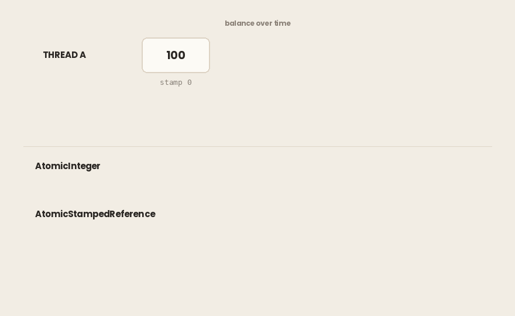

## TL;DR

- Un saldo `AtomicLong`, sin bloqueos, 8 hilos retirando 100 de 100: el saldo quedó en negativo en 4550–5683 de 10.000 rondas, hasta -700. Cada llamada era atómica. La comprobación y la escritura juntas no lo eran.
- El mismo programa con un bucle `compareAndSet`: 0 rondas en descubierto, en 5 de 5 ejecuciones.
- Ese bucle es la misma idea que la columna de versión del artículo de PostgreSQL, una capa más abajo: escribe solo si nada ha cambiado; si no, vuelve a empezar.
- En x86, el `getAndIncrement` compilado es una sola instrucción sin ningún bucle alrededor. Desactiva esa optimización y se convierte en un compare-and-set, con un bucle de reintentos en cuanto los hilos compiten.
- `updateAndGet` ejecutó su función 31.339.201–39.623.599 veces para 8.000.000 de actualizaciones con 8 hilos. La función no debe tener efectos secundarios.
- Sin bloqueo no significa sin espera: con 8 hilos fallaron 1,11–2,20 intentos por cada éxito, un incremento necesitó 6694 intentos y un volcado de hilos (thread dump) no mostró nada fuera de lo normal.
- `LongAdder` cambia memoria por rendimiento en los contadores muy disputados. No tiene compare-and-set y su `sum()` no es una instantánea, así que nunca compruebes un saldo con él.
- `compareAndSet` compara referencias: en una JVM por defecto, 127 coincide y 1000 no. Tampoco puede ver 100 -> 50 -> 100. Un sello (stamp) sí puede.
- Dos campos que deben cambiar juntos: dos `AtomicLong` dejaron que 600–797 de 10.000 ventanas superaran un límite de 10. Un único record inmutable: 0.

> ***Entorno de todas las salidas de este artículo:*** *Intel Core i7-4700HQ (4 núcleos / 8 hilos, x86-64), 16 GB DDR3-1600, Ubuntu 26.04, Amazon Corretto 25.0.4 (cada demo también se ejecutó en 21.0.11, misma dirección). Las cifras serán distintas en tu máquina; la dirección no. La sección de código máquina necesita x86-64.*

**Código fuente.** Todos los programas están en el repositorio [`article-examples`](https://github.com/mryakar/article-examples), en `cas-atomic-classes/`. Cada demo es un único archivo Java sin dependencias; el README tiene el comando de cada una.

---

## Cada campo es atómico

Vuelve la cuenta del artículo de `synchronized`. Allí, dos bloqueos sobre dos cuentas acabaron en deadlock. Aquí no hay ningún bloqueo, así que tampoco hay deadlock.

El saldo es un `AtomicLong`. Una retirada lo lee con `get()` y lo escribe con `addAndGet()`:

```java
static boolean withdraw(Account from, long amount) {
    if (from.balance.get() >= amount) {
        from.balance.addAndGet(-amount);
        return true;
    }
    return false;
}
```

Léelo línea a línea y nada parece incorrecto. Cada llamada sobre el saldo es atómica.

La cuenta `"A"` empieza con 100. Ocho hilos intentan retirar 100 de ella en el mismo instante, así que como mucho uno debería tener éxito. El programa lo repite 10.000 veces y cuenta las rondas que terminan por debajo de cero. Cinco ejecuciones:

```
overdrawn 4567/10000 rounds, lowest -700
overdrawn 5683/10000 rounds, lowest -700
overdrawn 5450/10000 rounds, lowest -700
overdrawn 4615/10000 rounds, lowest -600
overdrawn 4550/10000 rounds, lowest -600
```

En el JDK 25, alrededor de la mitad de las rondas quedaron en descubierto, en todas las ejecuciones. Un saldo de -700 significa que los ocho hilos retiraron: había 100 y salieron 800.

Cada llamada sobre el saldo era atómica. Entonces, ¿de dónde salió el descubierto?

### En resumen

- Un saldo `AtomicLong`, sin bloqueos, ocho hilos retirando 100 de 100 a la vez.
- Cada llamada sobre el saldo es atómica.
- El saldo quedó en negativo en 4550–5683 de 10.000 rondas, en las 5 ejecuciones.
- En las peores rondas retiraron los ocho, y el saldo terminó en -700.

---

## Lo que te da una llamada atómica

El primer artículo de Java terminó con un contador que perdía actualizaciones. `count++` es una lectura, una suma y una escritura, y dos hilos pueden estar a la vez dentro de esos tres pasos.

Aquí está ese contador dos veces. Dos hilos, un millón de incrementos cada uno; solo cambia el tipo del contador. Dos de las cinco ejecuciones:

```
volatile int : 927,485 of 2,000,000
AtomicInteger: 2,000,000 of 2,000,000
volatile int : 1,343,315 of 2,000,000
AtomicInteger: 2,000,000 of 2,000,000
```

`AtomicInteger` no perdió nada, en ninguna ejecución. Su `incrementAndGet()` lee, suma y escribe como **un único paso indivisible**. Ningún otro hilo puede ver ni cambiar el valor a medio camino.

Esa es toda la garantía, pero tiene un límite: cubre **una llamada**. Pon dos llamadas atómicas una al lado de la otra y obtienes dos pasos atómicos, no uno. Entre ellas, cualquier otro hilo es libre de ejecutarse.

Eso es exactamente lo que hace `withdraw`. `get()` es atómico. `addAndGet()` es atómico. Entre ambos, otros hilos también leen 100, también pasan la comprobación y también escriben. Cada comprobación era cierta cuando se ejecutó. Cuando se ejecutó su escritura, ya no lo era.

Dos llamadas atómicas dejan un hueco. ¿Qué lo cierra?

### En resumen

- `AtomicInteger` arregla el contador del primer artículo: 2.000.000 de 2.000.000, en cada ejecución.
- El mismo trabajo con `volatile int` se quedó en 927.485–1.343.315.
- La garantía es por llamada. Dos llamadas atómicas seguidas no son una operación atómica.
- El descubierto ocurre entre la comprobación y la escritura.

---

## Compare-and-set: la escritura condicional

La solución no es un bloqueo. Es una condición sobre la escritura.

`compareAndSet(expectedValue, newValue)` escribe solo si el valor sigue siendo el que esperabas, y te dice si lo hizo. En palabras de la documentación, *"establece atómicamente el valor a `newValue` si el valor actual `== expectedValue`."* Nadie espera. Un hilo que pierde recibe `false` y decide qué hacer a continuación.

Una retirada se convierte en un bucle: lee el saldo, compruébalo, intenta escribir y vuelve a empezar si otro escribió antes:

```java
static boolean withdrawCas(Account from, long amount) {
    while (true) {
        long current = from.balance.get();
        if (current < amount) return false;
        if (from.balance.compareAndSet(current, current - amount)) {
            return true;
        }
    }
}
```

Varios hilos pueden seguir leyendo 100 y pasando la comprobación. Solo un `compareAndSet` encuentra 100 allí. Los que pierden encuentran 0, no escriben nada y dan otra vuelta al bucle, donde ahora la comprobación falla.


El mismo programa, los mismos ocho hilos, las mismas 10.000 rondas; solo cambió el cuerpo de `withdraw`. Las cinco ejecuciones imprimieron la misma línea:

```
cas             overdrawn 0/10000 rounds, lowest 0
```

Si leíste el artículo de PostgreSQL sobre el bloqueo explícito, ya has visto esto. Terminaba con *"una tercera opción que no pertenece a ninguna de las dos columnas"*:

```sql
UPDATE accounts SET balance = ?, version = version + 1
 WHERE id = ? AND version = ?;
```

y con la frase *"Eso es compare-and-set, escrito en SQL. Java tiene la misma idea en hardware, y ese es el próximo artículo."* Este es ese artículo. La columna de versión y `compareAndSet` comparten una idea: escribe solo si nada ha cambiado desde que leíste; si no, vuelve a empezar. Una protege una fila; el otro, una celda de memoria.

### En resumen

- `compareAndSet` escribe solo si el valor sigue siendo el que leíste. Nadie espera.
- Una retirada se convierte en un bucle: leer, comprobar, compare-and-set, volver a empezar si falló.
- El mismo programa, con un bucle añadido: 0 rondas en descubierto de 10.000, en las 5 ejecuciones.
- Es la misma idea que la columna de versión del artículo de PostgreSQL, una capa más abajo.

---

## Una instrucción por debajo

¿Cómo puede el propio compare-and-set ser un solo paso? El artículo de `synchronized` prometía *"compare-and-swap y las clases atómicas construidas sobre él."* Esta sección mira sobre qué están construidas esas clases.

En x86, compare-and-set es una sola instrucción del procesador, `lock cmpxchg`: comparar y escribir en un paso que ningún otro núcleo puede partir. Aun así puede fallar, por eso va dentro de un bucle como el de arriba. ¿Ejecutan ese bucle todas las clases atómicas? El método más común, no. Cuando el JIT compila `getAndIncrement()`, usa otra instrucción, `lock xadd`, que suma y devuelve el valor anterior en un solo paso. No hay nada que comparar, así que no hay nada que reintentar. Desactiva esa optimización y el mismo método vuelve a `lock cmpxchg`:

```
getAndIncrement: lock xadd, loop: no
intrinsic off  : lock cmpxchg, loop: no
off, 4 threads : lock cmpxchg, loop: yes
```

Cinco ejecuciones, las mismas tres líneas. El bucle solo aparece en el código compilado cuando los hilos compiten. Con un hilo no había competencia, y el JIT compiló el camino del fallo como una salida poco frecuente de vuelta a código más lento, en lugar de como un bucle. Cómo imprimir y leer este código máquina está en el README del repositorio. No lo necesitas para usar la clase.

### En resumen

- Compare-and-set es una instrucción de CPU que puede fallar, por eso va dentro de un bucle.
- En x86, el `getAndIncrement` compilado es una instrucción sin ningún bucle alrededor.
- Desactiva esa optimización y se convierte en un compare-and-set, con un bucle de reintentos en cuanto los hilos compiten.

---

## El bucle puede ejecutar tu código dos veces

Rara vez escribes ese bucle a mano. `updateAndGet(fn)` lo escribe por ti: lee el valor, aplica tu función, hace compare-and-set con el resultado y vuelve a empezar si otro hilo llegó antes. Volver a empezar significa llamar otra vez a tu función. La documentación lo dice sin rodeos: *"La función debe estar libre de efectos secundarios, ya que puede volver a aplicarse cuando los intentos de actualización fallan por la contención entre hilos."*

¿Con qué frecuencia? Esta función cuenta sus propias llamadas, un millón de actualizaciones por hilo:

```java
value.updateAndGet(v -> {
    calls.incrementAndGet();   // a side effect
    return v + 1;
});
```

```
1 thread : 1,000,000 calls for 1,000,000 updates
8 threads: 39,623,599 calls for 8,000,000 updates
8 threads: 31,339,201 calls for 8,000,000 updates
```

Con un hilo, cada actualización tuvo éxito al primer intento: una llamada por actualización. Con ocho hilos, la más alta y la más baja de cinco ejecuciones muestran **entre cuatro y cinco llamadas por cada actualización**, en esta máquina. Contar las llamadas es en sí otra actualización compartida, así que se suma a la contención. El valor final fue correcto todas las veces. Solo se multiplicó el efecto secundario.

Así que dentro de esa función no va nada salvo el cálculo del nuevo valor. Una línea de log se imprimiría varias veces para una sola actualización. Un contador contaría de más. Una llamada a otro servicio se haría varias veces.

El artículo de MVCC tenía la misma regla una capa más arriba, para una transacción de base de datos: *"El cuerpo de la transacción se ejecutará más de una vez."* Aquí el cuerpo es tu lambda.

### En resumen

- `updateAndGet` ejecuta el bucle de compare-and-set por ti, tu función incluida.
- Con 8 hilos, la función se ejecutó 31.339.201–39.623.599 veces para 8.000.000 de actualizaciones.
- Con 1 hilo, llamadas y actualizaciones fueron iguales: 1.000.000 de cada.
- Mantén la función pura: sin logs, sin E/S, sin contadores propios.

---

## Sin bloqueo no significa sin espera

La sección anterior contó las llamadas a la función. Esta cuenta los propios intentos: un bucle de compare-and-set que cuenta sus fallos y no hace nada más, un millón de incrementos por hilo, con 1, 2, 4 y 8 hilos.

```
1 thread : 0.00 failed per success, worst 1
2 threads: 0.72 failed per success, worst 2092
4 threads: 0.89 failed per success, worst 849
8 threads: 2.20 failed per success, worst 6694
```

Cada línea es la quinta de cinco ejecuciones para ese número de hilos. Con un hilo, nunca falló nada. Con ocho, fallaron uno o dos intentos por cada uno que tuvo éxito: entre 1,11 y 2,20 en las cinco ejecuciones. El peor incremento individual cambia mucho de una ejecución a otra; en una necesitó 6694 intentos.

La razón es que todos los hilos se pelean por la misma posición de memoria, y solo un intento a la vez puede ganar. El primer artículo de Java mostró que el hardware mantiene las cachés sincronizadas: un núcleo escribe y a los demás se les avisa. Aquí los ocho hilos trabajan a la vez sobre esa única posición.

Ningún hilo espera un bloqueo, pero todos esperan su turno para ganar. Y nada lo muestra. Este es un volcado de hilos tomado mientras ocho hilos giran:

```
dump: RUNNABLE 8/8, waiting to lock 0, parked 0
dump: deadlock reported: no
```

Los ocho están `RUNNABLE`. Nada espera un bloqueo, nada está aparcado, no hay deadlock. En el artículo de `synchronized`, el volcado señalaba directamente el problema. Aquí no hay nada que señalar. Este tipo de contención solo lo ves si lo cuentas.

### En resumen

- Ningún hilo esperó un bloqueo y, aun así, con 8 hilos fallaron 1,11–2,20 intentos por cada éxito.
- Un solo incremento necesitó 6694 intentos.
- Un volcado de hilos mostró los 8 hilos RUNNABLE y nada esperando. Solo lo ves si lo cuentas.

---

## LongAdder: deja de pelear por una sola celda

Si todos se pelean por una celda, dales más celdas. El primer artículo de Java mencionaba *"`LongAdder` cuando el contador está muy disputado"* y decía que merece su propio artículo.

La idea es sencilla. Cuando los hilos compiten, un `LongAdder` reparte la cuenta entre varias variables, de modo que hilos distintos actualizan variables distintas. Leerlo las suma.

¿Cuánto más rápido es eso? Este artículo no tiene ningún benchmark para ello, y no va a adivinar. La documentación expone lo que cabe esperar: *"Con poca contención en las actualizaciones, las dos clases tienen características similares. Pero con mucha contención, el rendimiento esperado de esta clase es significativamente mayor, a costa de un mayor consumo de espacio."*

El precio está en la lectura. Sobre `sum()`, la documentación dice: *"El valor devuelto NO es una instantánea atómica; invocado en ausencia de actualizaciones concurrentes devuelve un resultado exacto, pero las actualizaciones concurrentes que ocurran mientras se calcula la suma pueden no incorporarse."* La descripción de la clase ya dice para qué sirve: estadísticas, *"no para un control de sincronización de grano fino."*

Así que, volviendo al principio: **un saldo nunca es un `LongAdder`.** No tiene compare-and-set: puede sumar, pero no puede escribir solo si una comprobación sigue siendo cierta. Y `sum()` puede perderse las actualizaciones que ocurren mientras suma.

### En resumen

- `LongAdder` reparte un contador muy disputado entre varias variables y las suma cuando lo lees.
- Su documentación espera un rendimiento mucho mayor con mucha contención, pagado en memoria.
- No tiene compare-and-set, y `sum()` no es una instantánea. Nunca lo uses para un valor que compruebas antes de actuar.

---

## Qué compara realmente compareAndSet

`compareAndSet` hace una sola pregunta: ¿sigue siendo el valor el que leí? Hay dos maneras en que la respuesta puede engañarte.

**Compara referencias.** En un `AtomicReference`, la escritura ocurre *"si el valor actual `== expectedValue`"*: `==`, no `equals()`. Mete en él números empaquetados (boxed) y prueba `compareAndSet(127, 128)` sobre una referencia que contiene 127, y luego `compareAndSet(1000, 1001)` sobre una que contiene 1000:

```
default JVM:   CAS(127) = true  CAS(1000) = false
cache 1000:    CAS(127) = true  CAS(1000) = true
```

En una JVM por defecto, 127 coincidió y 1000 no. La JVM reutiliza un mismo objeto `Integer` para los valores pequeños, así que los dos `127` son el mismo objeto; cada `1000` es uno nuevo. La segunda línea es el mismo programa con una caché más grande:

```
java -XX:AutoBoxCacheMax=1000 IdentityTrap cache1000
```

Ahora 1000 también coincide. El lenguaje garantiza un objeto compartido solo de -128 a 127; más allá, depende de la JVM. Para números, `AtomicInteger` evita la cuestión por completo. La regla es breve: **pasa la referencia que leíste** como valor esperado, no un valor nuevo que parezca igual.

**No puede ver la historia.** Un hilo lee un saldo de 100 y está a punto de escribir 70. Antes de hacerlo, otro hilo cambia el saldo a 50 y luego otra vez a 100. El `compareAndSet(100, 70)` del primer hilo tiene éxito: el valor es el mismo. Pero alguien lo tocó entretanto. "El mismo valor" y "nadie lo tocó" son afirmaciones distintas. Este es el **problema ABA**. Para un número sin más no hace daño: 70 sigue siendo el resultado correcto. Importa cuando el valor representa algo más que a sí mismo, cuando "nada ha cambiado desde que lo leí" es la regla que estás haciendo cumplir.

`AtomicStampedReference` guarda un sello entero junto al valor y compara los dos. Cada escritor debe mover el sello, así que un cambio y su deshacer siguen dejando una marca:



```
plain   : CAS(100 -> 70) = true
stamped : CAS(100 -> 70) = false (stamp 0, now 2)
```

Una columna de versión es el mismo sello. `WHERE balance = ?` no notaría 100 -> 50 -> 100. `WHERE version = ?`, sí.

### En resumen

- `compareAndSet` sobre un `AtomicReference` compara referencias, no `equals()`.
- En una JVM por defecto, 127 coincidió y 1000 no. Pasa la referencia que leíste.
- No puede ver 100 -> 50 -> 100. `AtomicStampedReference` sí: el sello era 0 y ahora era 2.
- Una columna de versión es el mismo sello.

---

## Cuando una variable no basta

La documentación del paquete expone su propio límite en su primera frase: *"Un pequeño conjunto de clases que permiten programar sin bloqueos y de forma segura entre hilos sobre variables individuales."* **Variables individuales.**

Toma un limitador: como mucho 10 peticiones por ventana de tiempo. Guarda dos valores: cuándo empezó la ventana actual y cuántas peticiones ha dejado pasar. Cuando empieza una ventana nueva, los dos deben cambiar juntos.

Con dos `AtomicLong`, cada llamada es atómica y la decisión no lo es. Varios hilos ven la ventana nueva más o menos a la vez, y cada uno fija el inicio y pone la cuenta a cero. Un reinicio que ocurre cuando otros hilos ya han contado borra sus cuentas. La cuenta vuelve a empezar y pasan más peticiones.

Ocho hilos envían cuatro peticiones cada uno a la misma ventana: 32 intentos, como mucho deberían pasar 10. Diez mil ventanas, dos de cinco ejecuciones, y después la solución:

```
two-atomics over limit in 797/10000 windows, most 32
two-atomics over limit in 600/10000 windows, most 31
one-record  over limit in 0/10000 windows, most 10
```

`most 32` significa que en al menos una ventana pasaron todas y cada una de las peticiones.

La solución mete los dos valores en un único record inmutable y lo sustituye entero de una vez:

```java
record Window(long start, int count) {}

public boolean tryAcquire(long now) {
    while (true) {
        Window w = window.get();
        Window next;
        if (w.start() != now) next = new Window(now, 1);
        else if (w.count() >= LIMIT) return false;
        else next = new Window(now, w.count() + 1);
        if (window.compareAndSet(w, next)) return true;
    }
}
```

El mismo bucle que la retirada: leer, decidir, compare-and-set, volver a empezar si falla. Los dos valores cambian en una sola escritura, así que ningún hilo ve nunca uno sin el otro. Fíjate en que el valor esperado es `w`, la referencia que se leyó: la regla de la sección anterior. Un `Window` nuevo con los mismos campos nunca coincidiría.

Esto funciona porque construir un `Window` es barato y no tiene efectos secundarios. Si la actualización es cara, cada intento fallido la repite. Si tiene efectos secundarios, también se repiten. Entonces un bloqueo pequeño, como en el artículo de `synchronized`, es la respuesta honesta.

### En resumen

- Las clases atómicas protegen una variable. Dos campos que deben cambiar juntos son una sola decisión.
- Dos `AtomicLong` dejaron que 600–797 de 10.000 ventanas superaran un límite de 10, hasta 32.
- Un único record inmutable detrás de un `AtomicReference`: 0 ventanas por encima del límite, en cada ejecución.
- Si la actualización es cara o tiene efectos secundarios, un bloqueo pequeño es la respuesta honesta.

---

## Bloqueo, atómico o ninguno

- **Un contador, pocos escritores:** `AtomicInteger` o `AtomicLong`
- **Un contador, muchos escritores, se lee poco:** `LongAdder`
- **Comprobar y luego escribir un valor:** un bucle `compareAndSet`, o `updateAndGet` con una función pura
- **Varios valores, una regla:** un único record inmutable en un `AtomicReference`, o un bloqueo
- **Efectos secundarios en la actualización:** un bloqueo

El artículo de `synchronized` terminaba con *"El bloqueo más rápido es el que no tomaste"*. Sigue siendo cierto, pero el coste del bloqueo que no tomaste no desaparece. Se traslada al bucle: intentos fallidos, funciones que se ejecutan dos veces, contención que ningún volcado de hilos muestra.

Cada bucle de compare-and-set de este artículo es un reintento que solo toca memoria. El próximo artículo trata de los reintentos que tocan una base de datos, una red y el dinero de alguien, y de qué hace seguro ejecutarlos dos veces.

### En resumen

- Un valor, una regla: una clase atómica. Comprobar y luego escribir: un bucle de compare-and-set.
- Contadores muy disputados: `LongAdder`, nunca para un valor que compruebas.
- Varios valores: un único record inmutable, o un bloqueo.

---

## Referencias

**Documentación de la API**

- *java.util.concurrent.atomic — package summary.* La frase de las "variables individuales".
  [https://docs.oracle.com/en/java/javase/25/docs/api/java.base/java/util/concurrent/atomic/package-summary.html](https://docs.oracle.com/en/java/javase/25/docs/api/java.base/java/util/concurrent/atomic/package-summary.html)
- *AtomicInteger* — `compareAndSet`, `getAndIncrement`, `updateAndGet` y la regla de no tener efectos secundarios.
  [https://docs.oracle.com/en/java/javase/25/docs/api/java.base/java/util/concurrent/atomic/AtomicInteger.html](https://docs.oracle.com/en/java/javase/25/docs/api/java.base/java/util/concurrent/atomic/AtomicInteger.html)
- *AtomicReference* — `compareAndSet` con `==`.
  [https://docs.oracle.com/en/java/javase/25/docs/api/java.base/java/util/concurrent/atomic/AtomicReference.html](https://docs.oracle.com/en/java/javase/25/docs/api/java.base/java/util/concurrent/atomic/AtomicReference.html)
- *AtomicStampedReference* — una referencia más un sello entero, actualizados juntos.
  [https://docs.oracle.com/en/java/javase/25/docs/api/java.base/java/util/concurrent/atomic/AtomicStampedReference.html](https://docs.oracle.com/en/java/javase/25/docs/api/java.base/java/util/concurrent/atomic/AtomicStampedReference.html)
- *LongAdder* — el compromiso entre contención y memoria, y `sum()` como algo que no es una instantánea.
  [https://docs.oracle.com/en/java/javase/25/docs/api/java.base/java/util/concurrent/atomic/LongAdder.html](https://docs.oracle.com/en/java/javase/25/docs/api/java.base/java/util/concurrent/atomic/LongAdder.html)
- *Integer.valueOf* — qué valores empaquetados se garantiza que se compartan.
  [https://docs.oracle.com/en/java/javase/25/docs/api/java.base/java/lang/Integer.html](https://docs.oracle.com/en/java/javase/25/docs/api/java.base/java/lang/Integer.html)

**Para seguir leyendo**

- Brian Goetz et al., *Java Concurrency in Practice*, capítulo 15 — *Atomic Variables and Nonblocking Synchronization.*
- Martin Kleppmann y Chris Riccomini, *Designing Data-Intensive Applications*, 2.ª edición, capítulo 8 — escrituras condicionales (compare-and-set).
