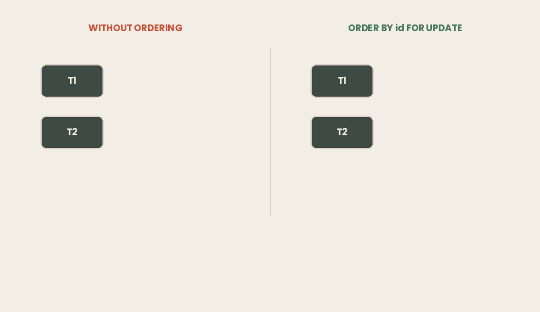

## TL;DR

- Dos sentencias `UPDATE` corrientes bastan para un deadlock. No hace falta escribir un solo bloqueo para llegar a `40P01`.
- Los nombres de los bloqueos a nivel de tabla engañan: `ROW SHARE` y `ROW EXCLUSIVE` son bloqueos de **tabla**. Lo único que importa es la lista de conflictos.
- **Solo** `ACCESS EXCLUSIVE` **bloquea un** `SELECT` **corriente.** Eso es lo que hace peligrosos en producción `ALTER TABLE`, `DROP`, `TRUNCATE` y `VACUUM FULL`, y seguras, con `CONCURRENTLY`, las creaciones de índices.
- Los bloqueos de fila tienen cuatro modos sobre dos ejes: compartido o exclusivo, que toca la clave o no. Los dos del medio existen para que **las comprobaciones de clave foránea no bloqueen las actualizaciones corrientes**.
- **Los bloqueos de fila nunca bloquean a los lectores.** Solo espera otro escritor sobre la misma fila.
- El mismo `SELECT ... FOR UPDATE` se comporta de forma distinta en cada nivel de aislamiento: **Read Committed se adapta, Repeatable Read se rinde** con un fallo de serialización.
- Aquí el deadlock es el mismo problema que en Java: **espera circular**, y se arregla igual, con un orden de bloqueo coherente, que en SQL es `ORDER BY id FOR UPDATE`.
- **La víctima no es aleatoria.** Cada sesión en espera busca un ciclo exactamente una vez, `deadlock_timeout` después de empezar a esperar, y quien hace esa comprobación se aborta a sí misma. Con un tiempo demasiado bajo, tu comprobación se ejecuta *antes* de que exista el ciclo: el mismo deadlock tardó 0,2 s o 10,0 s en detectarse, dependiendo solo de a qué estaba puesto el temporizador de cada uno.
- **Los bloqueos consultivos (advisory locks) bloquean un número, no una fila.** Son reentrantes, y cuántas veces los tiene una sesión es invisible en `pg_locks`.
- Un bloqueo consultivo a nivel de sesión **sobrevive a** `ROLLBACK` **y sobrevive a la devolución de la conexión al pool.** Así es como «solo una instancia ejecuta esta tarea» falla en silencio.

> ***Entorno de todas las salidas de este artículo:***
>
> - *Intel Core i7–4700HQ (4 núcleos / 8 hilos, x86–64), 16 GB DDR3–1600*
>
> - *Ubuntu 26.04*
>
> - *PostgreSQL 18.6 con* `autovacuum` *desactivado.*
>
> *Todos los escenarios SQL de abajo están en el repositorio* ***article-examples****, en* `postgres-explicit-locking/`*, con los pasos numerados para que puedas ejecutarlos tú mismo en dos o tres sesiones de psql.*
>
> *Código: [*[*github.com/…*](https://github.com/mryakar/article-examples/tree/master/postgres-explicit-locking)*]*

## El deadlock que no pediste

Dos cuentas, dos transacciones, dinero moviéndose en ambas direcciones.

```sql
-- T1                                    -- T2
BEGIN;                                   BEGIN;
UPDATE ... SET balance-100 WHERE id=100;
                                         UPDATE ... SET balance-100 WHERE id=200;
UPDATE ... SET balance+100 WHERE id=200;  -- waits
                                         UPDATE ... SET balance+100 WHERE id=100;
```

Ningún `LOCK TABLE`, ninguna sentencia de bloqueo explícito de ningún tipo: cuatro `UPDATE` corrientes. La segunda sentencia de T1 se bloquea. Entonces T2 ejecuta la suya, y la base de datos responde:

```bash
ERROR:  40P01: deadlock detected
DETAIL:  Process 1583 waits for ShareLock on transaction 760; blocked by process 1584.
         Process 1584 waits for ShareLock on transaction 761; blocked by process 1583.
HINT:  See server log for query details.
CONTEXT:  while updating tuple (0,1) in relation "accounts"
```

T2 se aborta. T1 despierta, termina y hace commit: `100 | Ali | 900.00`, `200 | Ayşe | 1100.00`.

Nadie pidió un bloqueo. Postgres los tomó de todos modos.

### En resumen

- Dos `UPDATE` sobre dos filas, en orden opuesto, bastan para un deadlock.
- En ninguna parte del código se escribió un bloqueo explícito.
- Postgres detectó el ciclo y abortó una transacción con `40P01`; la otra hizo commit.
- Cuál muere, y por qué, viene después.

## Los bloqueos que tomas sin pedirlos

Los nombres engañan: `ROW SHARE` y `ROW EXCLUSIVE` son bloqueos **a nivel de tabla**. La documentación lo dice directamente: *«todos estos modos de bloqueo son bloqueos a nivel de tabla, aunque el nombre contenga la palabra row; los nombres de los modos de bloqueo son históricos»*. Además, no tienen ningún comportamiento propio. Un modo es solo una **lista de modos con los que entra en conflicto**: dos transacciones no pueden tener a la vez modos en conflicto sobre la misma tabla, y todo lo demás se ejecuta.

```
lock mode                taken by
-----------------------  -------------------------------------------
ACCESS SHARE             SELECT
ROW SHARE                SELECT ... FOR UPDATE / FOR SHARE
ROW EXCLUSIVE            INSERT, UPDATE, DELETE
SHARE UPDATE EXCLUSIVE   VACUUM, ANALYZE, CREATE INDEX CONCURRENTLY
SHARE                    CREATE INDEX
SHARE ROW EXCLUSIVE      CREATE TRIGGER
EXCLUSIVE                REFRESH MATERIALIZED VIEW CONCURRENTLY
ACCESS EXCLUSIVE         DROP, TRUNCATE, VACUUM FULL, most ALTER TABLE
```

Los tres primeros no entran en conflicto entre sí, así que lectores, insertadores y actualizadores nunca hacen cola a nivel de tabla; cuando dos de ellos sí esperan, es por una **fila**. En el otro extremo de la lista, `ACCESS EXCLUSIVE` **es el único modo que bloquea un** `SELECT` **corriente:**

```sql
T1: BEGIN; LOCK TABLE accounts IN ROW EXCLUSIVE MODE;
T2: SELECT count(*) FROM accounts;      -- does not wait
T2: INSERT INTO accounts ...;           -- does not wait

T1: BEGIN; LOCK TABLE accounts IN ACCESS EXCLUSIVE MODE;
T2: SELECT count(*) FROM accounts;      -- BLOCKED
```

Ese segundo bloqueo es lo que hace arriesgadas las migraciones: la sentencia puede ser rápida, pero primero tiene que adquirir el bloqueo, y mientras espera detrás de una consulta larga, cada nuevo `SELECT` hace cola detrás de ella. Las creaciones de índices muestran las dos caras: `CREATE INDEX` toma `SHARE` y detiene las escrituras; `CREATE INDEX CONCURRENTLY` toma `SHARE UPDATE EXCLUSIVE` y no las detiene, a costa de dos recorridos de la tabla y de no poder ir en un bloque de transacción.

Hay una propiedad que importa para dos secciones posteriores: **un bloqueo se mantiene hasta que termina la transacción**, nunca se libera antes.

### En resumen

- Cada sentencia toma un bloqueo a nivel de tabla, lo pidas o no.
- Los nombres son históricos: `ROW EXCLUSIVE` es un bloqueo de tabla.
- Un modo de bloqueo no tiene comportamiento propio, solo una lista de conflictos.
- `SELECT`, `INSERT` y `UPDATE` no entran en conflicto a nivel de tabla.
- Solo `ACCESS EXCLUSIVE` bloquea un `SELECT` corriente. Eso es lo que hace peligroso el DDL.

## Reservar una fila: FOR UPDATE y sus tres hermanos

`SELECT ... FOR UPDATE` significa: estoy leyendo esta fila, voy a escribir en función de lo que lea y nadie puede cambiarla entretanto. Es el bloqueo para la lógica de comprobar y luego actuar. Hay cuatro modos así, sobre dos ejes: compartido o exclusivo, que toca la clave o no.

```
            mode                what it reserves
            ------------------  ------------------------------------
shared      FOR KEY SHARE       only the key: no change, no delete
            FOR SHARE           the whole row, while I read it

exclusive   FOR NO KEY UPDATE   the row, except its key
            FOR UPDATE          the whole row
```

Dos modos compartidos conviven; un modo exclusivo no convive con nada. `FOR UPDATE` entra en conflicto con los cuatro; `FOR KEY SHARE`, solo con `FOR UPDATE`.

Un coste antes de usar `FOR UPDATE` sobre un conjunto de resultados grande: un bloqueo de fila no se guarda en memoria. Se **escribe en la tupla**, en el campo `xmax`, el mismo que escribe un `UPDATE` o un `DELETE`. Un millón de filas bloqueadas son un millón de escrituras de tupla, cada una con su tráfico de WAL y su trabajo posterior de vacuum; no hay ningún límite de la tabla de bloqueos que alcanzar, porque los bloqueos están en disco. Esto también responde a algo que el artículo anterior dejó abierto: un `xmax` distinto de cero puede significar que la fila solo está bloqueada, no borrada.

### En resumen

- Cuatro modos sobre dos ejes: compartido o exclusivo, que toca la clave o no.
- Dos modos compartidos conviven; un modo exclusivo no convive con nada.
- `FOR UPDATE` es el de la lógica de comprobar y luego actuar.
- Un bloqueo de fila se escribe en el `xmax` de la tupla, así que un millón de filas cuestan un millón de escrituras.

## Por qué existen los modos del medio

`FOR KEY SHARE` y `FOR NO KEY UPDATE` existen por las **claves foráneas**. Tres transacciones sobre una tabla `customers` y su tabla hija `orders`:

```sql
T1: BEGIN; INSERT INTO orders(customer_id, amount) VALUES (42, 100);
    -- the FK check takes FOR KEY SHARE on customers(42)
T2: BEGIN; UPDATE customers SET name = 'Ali Veli' WHERE id = 42;
    -- name is not a key -> FOR NO KEY UPDATE -> does NOT wait
T3: BEGIN; DELETE FROM customers WHERE id = 42;
    -- DELETE always takes FOR UPDATE -> WAITS
```

T2 no espera, T3 sí, y la única diferencia es qué modo necesita cada una. Postgres elige el modo mirando lo que has tocado: una comprobación de clave foránea toma `FOR KEY SHARE` sobre la fila padre, un `UPDATE` toma `FOR UPDATE` si toca una columna de clave y `FOR NO KEY UPDATE` si no, y un `DELETE` siempre toma `FOR UPDATE`.

Sin los modos del medio, una comprobación de clave foránea tendría que tomar el exclusivo. Cada `INSERT` en `orders` bloquearía la fila del cliente, y cada petición que cambiara el nombre de ese cliente haría cola detrás: un cuello de botella incorporado al esquema para cualquier fila a la que apunten muchos hijos.

### En resumen

- Los modos del medio existen para que las comprobaciones de clave foránea no bloqueen las actualizaciones corrientes.
- Un `INSERT` en una tabla hija toma `FOR KEY SHARE` sobre la fila padre.
- Un `UPDATE` que no toca la clave toma `FOR NO KEY UPDATE` y no entra en conflicto con él.
- `DELETE` siempre toma `FOR UPDATE` y sí entra en conflicto.
- Postgres elige el modo según las columnas que tocas.

## Los bloqueos de fila no bloquean a los lectores

T1 bloquea la fila 100 y la mantiene. Entonces T2 intenta cuatro cosas:

```sql
T2: SELECT * FROM accounts WHERE id = 100;     -- does not wait, returns 1000.00
T2: SELECT count(*) FROM accounts;             -- does not wait
T2: UPDATE accounts SET ... WHERE id = 200;    -- does not wait
T2: UPDATE accounts SET ... WHERE id = 100;    -- BLOCKED
```

Tres de cuatro no esperan. La fila bloqueada sigue siendo legible, como la última versión confirmada: MVCC, tal como se describió en el artículo anterior. Un bloqueo reserva la fila para *escribir*, así que solo espera la cuarta sentencia.

Por tanto, la granularidad del bloqueo es la granularidad de la contención. En una tabla de un millón de cuentas, mantener la fila 100 afecta a las transacciones que tocan la fila 100 y a nada más: dos pagos desde la misma cuenta se serializan, como exige la corrección, y dos pagos desde cuentas distintas nunca se cruzan.

### En resumen

- Una fila bloqueada con `FOR UPDATE` sigue siendo legible por cualquier `SELECT` corriente, sin esperar.
- Los recorridos completos no se ven afectados; solo espera un escritor sobre la misma fila.
- La granularidad del bloqueo es la granularidad de la contención: clientes distintos nunca se tocan.

## FOR UPDATE en los distintos niveles de aislamiento

La espera es idéntica en los tres niveles. La diferencia aparece *después* de que la otra transacción haga commit. T1 lee un saldo de 1000.00 y mantiene su instantánea, T2 cambia esa fila a 500.00 y hace commit, y entonces T1 ejecuta `SELECT ... FOR UPDATE` sobre ella:

```
Read Committed    500.00, no error
Repeatable Read   ERROR:  could not serialize access
Serializable      ERROR:  could not serialize access
```

El mensaje completo en los dos casos de error es `could not serialize access due to concurrent update`.

Read Committed **se adapta**: espera al ganador, luego bloquea la versión *nueva* y vuelve a evaluar la cláusula `WHERE` contra ella. Repeatable Read **se rinde**, porque su instantánea está congelada durante toda la transacción y la fila que le entregan no es la fila que aceptó ver.

Este es el lado del bloqueo de un comportamiento que el artículo anterior mostró desde la otra dirección: en Read Committed, un `UPDATE ... WHERE balance > 500` que pierde una carrera vuelve a comprobar su condición y se salta la fila en silencio si ya no la cumple, y solo lo informa como `UPDATE 0`. `FOR UPDATE` lo evita. Con Serializable ocurre lo contrario: normalmente no hace falta, porque SSI ya sigue las dependencias de lectura-escritura, y añadir bloqueos encima te da la espera *y* los reintentos.

### En resumen

- Los tres niveles esperan igual; se diferencian después de que el ganador haga commit.
- Read Committed bloquea la versión nueva y vuelve a evaluar `WHERE`. Sin error.
- Repeatable Read y Serializable lanzan un fallo de serialización. Tienes que reintentar.
- Elige uno: bloqueo pesimista en Read Committed o reintento optimista en Serializable.

## El mismo problema: espera circular

Ahora, la respuesta al principio. Las dos transacciones tomaron bloqueos de fila en orden opuesto: T1 bloqueó la fila 100 y luego quiso la 200; T2 bloqueó la fila 200 y luego quiso la 100. Cada una tiene lo que la otra necesita, y ninguna puede liberar antes, porque un bloqueo de fila vive hasta el final de su transacción.


*Ninguna de las dos transacciones menciona un bloqueo. Los tomaron las sentencias* `UPDATE`*, y el orden en que los tomaron es el fallo.*

Es el mismo fallo que el de dos hilos de Java que llaman a `synchronized` sobre dos cuentas en orden opuesto: el mismo ciclo, las mismas cuatro condiciones, la misma solución. El deadlock es un problema de **orden de los recursos**, no de una base de datos o de un lenguaje. Lo que cambia es la respuesta: PostgreSQL detecta el ciclo y aborta a un participante, mientras que la JVM lo detecta, lo imprime en un volcado de hilos y no hace nada.

**La ordenación lo elimina.** Bloquea las filas en un orden fijo, en una sola sentencia:

```sql
SELECT id FROM accounts WHERE id IN (100, 200) ORDER BY id FOR UPDATE;
```

Ahora las dos transacciones adquieren en la misma dirección, y la segunda se bloquea en la fila 100 **sin tener nada**:



*La perdedora espera en la primera fila. No hay una segunda arista sobre la que cerrar un ciclo.*

Esto es estructural, no estadístico: a una transacción que no tiene nada no puede esperarla nadie, así que el grafo de espera no puede contener un ciclo.

**La primera sorpresa: la ordenación no siempre basta.** Dos transacciones leen la misma fila con `FOR SHARE`: sin conflicto, las dos lo consiguen. Luego las dos intentan subir a `FOR UPDATE`, y cada una espera el bloqueo compartido de la otra:

```bash
ERROR:  deadlock detected
CONTEXT:  while locking tuple (0,1) in relation "accounts"
```

Una sola fila, el mismo orden, y aun así deadlock. No hay nada que ordenar, así que la solución es el modo: **toma el bloqueo más restrictivo que vayas a necesitar la primera vez que toques la fila.** Fíjate también en la línea `CONTEXT`: el deadlock del principio decía `while updating tuple`, este dice `while locking tuple`, lo que te indica si la colisión fue una escritura corriente o una petición de bloqueo explícita.

**La segunda sorpresa: la víctima no es aleatoria.** El consejo habitual es que no puedes predecir qué transacción se aborta, y la documentación está de acuerdo: el resultado *«es difícil de predecir y no se debe confiar en él»*. El consejo es correcto; la explicación que hay detrás suele faltar.

`deadlock_timeout` es un ajuste **por sesión**. Una sesión que empieza a esperar arma un temporizador. Cuando salta, esa sesión recorre el grafo de espera y, **si encuentra un ciclo, se aborta a sí misma**. El servidor no elige entre candidatas: la víctima es la sesión que hizo su comprobación mientras existía el ciclo.

Tres casos, cinco ejecuciones cada uno, el mismo deadlock cada vez:

```
deadlock_timeout       cycle forms          victim      detected in
T1        T2
--------  --------     ------------------   ---------   -----------
200 ms    10 s         before T1's check    T1   5/5     0.2 s
10 s      200 ms       before T2's check    T2   5/5     0.2 s
200 ms    10 s         AFTER  T1's check    T2   5/5    10.0 s
```

En el tercer caso, T1 tiene el temporizador de 200 ms y *no* es quien se da cuenta. Su comprobación se ejecutó a los 200 ms, no encontró ningún ciclo porque el ciclo aún no existía, y no volvió a ejecutarse; el deadlock se formó a los 300 ms y retuvo las dos transacciones hasta que saltó el temporizador de diez segundos de T2.

Cada sesión en espera comprueba **exactamente una vez** por espera. El código fuente lo muestra: `ProcSleep` arma `DEADLOCK_TIMEOUT` una vez antes del bucle de espera y nunca lo vuelve a armar, y dentro del bucle se ejecuta `CheckDeadLock` y se borra la marca. La razón es el coste: *«al retrasar la comprobación hasta haber esperado un poco, podemos evitar en la mayoría de los casos ejecutar el código de comprobación de deadlocks, bastante caro»*.

Así que **bajar** `deadlock_timeout` **puede hacer que la detección llegue más tarde, no antes.** Tu aplicación no cambia en ningún caso: captura el error y reintenta desde el principio, con `40001` y `40P01` en la lista de reintentos.

### En resumen

- El deadlock del principio vino de tomar dos bloqueos de fila en orden opuesto: espera circular, el mismo fallo que el de dos hilos de Java que bloquean dos cuentas.
- La ordenación de bloqueos lo elimina estructuralmente: la que espera lo hace sin tener nada.
- No sirve cuando dos transacciones suben un bloqueo compartido sobre la misma fila. Toma desde el principio el modo más restrictivo.
- La víctima es la sesión que hace su comprobación mientras existe el ciclo. Bajar `deadlock_timeout` puede retrasar la detección: 10,0 s en lugar de 0,2 s.

## Bloquear un número, no una fila

Todo lo anterior bloqueaba datos. Los bloqueos consultivos bloquean un **número**: `SELECT pg_advisory_lock(42)`. No hay ninguna fila 42 ni ninguna tabla 42: solo tu aplicación sabe qué significa 42, y Postgres no impone nada.

Existen para un patrón: **solo una instancia del clúster debe hacer esto.** El proceso por lotes nocturno, el relé del outbox, la tarea programada que no debe ejecutarse dos veces. Flyway toma un bloqueo de este tipo antes de migrar; ShedLock está construido sobre él. La variante que importa es `pg_try_advisory_lock`, que devuelve el resultado de inmediato en lugar de hacer cola:

```sql
instance A:  SELECT pg_try_advisory_lock(42);   ->  t     -- runs the job
instance B:  SELECT pg_try_advisory_lock(42);   ->  f     -- skips, no wait
instance C:  SELECT pg_try_advisory_lock(42);   ->  f     -- skips, no wait
```

La alternativa obvia, un booleano `job_running`, es peor por tres motivos: cada vez que se activa o desactiva escribe una nueva versión de fila y alimenta la hinchazón (bloat), es más lenta, y una caída a mitad de la tarea deja la marca en `true` para siempre. Un bloqueo consultivo se libera cuando termina su sesión.

Hay dos duraciones:

```sql
pg_advisory_lock(n)             -- session level
   released by   explicit unlock, or the session ending
   ROLLBACK      no effect: you still hold it
   unlock        required; N acquires need N releases

pg_advisory_xact_lock(n)        -- transaction level
   released by   end of transaction, automatically
   ROLLBACK      releases it
   unlock        not available, not needed
```

La fila de `ROLLBACK` se puede medir:

```sql
A: BEGIN; SELECT pg_advisory_lock(77); ROLLBACK;
A: SELECT count(*) FROM pg_locks WHERE locktype='advisory';   ->  1
B: SELECT pg_try_advisory_lock(77);                           ->  f

A: BEGIN; SELECT pg_advisory_xact_lock(88); ROLLBACK;
A: SELECT count(*) FROM pg_locks WHERE locktype='advisory';   ->  0
```

Se hizo rollback de la transacción; el bloqueo a nivel de sesión se sigue manteniendo. La documentación lo dice: las peticiones a nivel de sesión *«no respetan la semántica transaccional»*.

Hay dos propiedades más que importan para la sección siguiente. Los bloqueos consultivos son **reentrantes** (una sesión que tiene uno siempre lo vuelve a obtener, aunque haya otras en cola detrás, y cada adquisición necesita su propia liberación) y el recuento es **invisible**:

```sql
A: SELECT pg_try_advisory_lock(42);  -> t
A: SELECT pg_try_advisory_lock(42);  -> t        -- same session, again

A: SELECT locktype, objid, mode FROM pg_locks WHERE locktype='advisory';
    locktype | objid |     mode
   ----------+-------+---------------
    advisory |    42 | ExclusiveLock              -- ONE row

A: SELECT pg_advisory_unlock(42);    -> t
B: SELECT pg_try_advisory_lock(42);  -> f        -- still held
A: SELECT pg_advisory_unlock(42);    -> t
B: SELECT pg_try_advisory_lock(42);  -> t        -- now it is free
```

Un bloqueo que se tiene dos veces se ve igual que uno que se tiene una vez, y no puedes preguntarle a la base de datos cuántas liberaciones faltan.

Dos límites de la documentación. Los bloqueos consultivos comparten con los bloqueos normales un pool fijo de memoria compartida, cuyo tamaño depende de `max_locks_per_transaction` y `max_connections`, así que un bloqueo por usuario acabará agotándolo y entonces el servidor no podrá conceder ningún bloqueo. Y en `SELECT pg_advisory_lock(id) FROM foo WHERE id > 12345 LIMIT 100` no está garantizado que el `LIMIT` se aplique antes de ejecutar la función, así que puedes tomar bloqueos que nunca pretendiste tomar y que nunca liberarás; pon el `LIMIT` en una subconsulta. Una herramienta relacionada: un bloqueo consultivo significa *una instancia hace esta tarea*, mientras que `SELECT ... FOR UPDATE SKIP LOCKED` significa *un trabajador toma este elemento*.

### En resumen

- Un bloqueo consultivo bloquea un número que eliges tú; Postgres no comprueba qué significa.
- Usa `pg_try_advisory_lock` para que los perdedores se salten la ronda en lugar de hacer cola.
- Un bloqueo a nivel de sesión sobrevive a `ROLLBACK`. Uno a nivel de transacción, no.
- Son reentrantes, y `pg_locks` nunca muestra cuántas veces se tiene uno.
- Prefiere `pg_advisory_xact_lock`, salvo que el trabajo abarque más de una transacción.

## El bloqueo fantasma de tu pool de conexiones

Combina las dos últimas propiedades con un pool de conexiones. Una petición toma un bloqueo consultivo a nivel de sesión, hace su trabajo y devuelve la conexión, y entretanto se pierde el desbloqueo: por un return anticipado, una excepción o una refactorización que sacó la liberación del camino.

```java
try (Connection c = pool.getConnection()) {
    if (tryAdvisoryLock(c, JOB_ID)) {
        runTheJob(c);
    }
}   // close() does NOT close the connection. It returns it to the pool.
```

HikariCP sí limpia al devolver: hace rollback de una transacción abierta y restablece `autoCommit`, el aislamiento y la marca de solo lectura. Lo que no restablece es el **estado de la sesión**: no envía ningún `DISCARD ALL`, y el bloqueo consultivo es estado de la sesión.

Tres peticiones a través de un pool de una sola conexión, contra 18.6:

```sql
request #1 pid 2299  pg_try_advisory_lock(42) -> true  => RUNS THE JOB
request #2 pid 2299  pg_try_advisory_lock(42) -> true  => RUNS THE JOB
request #3 pid 2299  pg_try_advisory_lock(42) -> true  => RUNS THE JOB
round 1  pool OPEN    advisory lock rows: 1     (expected 1)
round 1  pool OPEN    outsider can take it: false (expected false)
round 1  pool CLOSED  advisory lock rows: 0     (expected 0)
```


*El mismo proceso de backend para las tres peticiones. La guarda devuelve true cada vez, y una fila de bloqueo en el servidor es todo lo que puedes ver.*

El daño va en dos direcciones. **Hacia fuera:** ninguna otra instancia puede tomar ese bloqueo, así que la tarea que todas protegían deja de ejecutarse en todas partes y nada informa de un error. **Hacia dentro:** la instancia con la fuga pasa su propia guarda; las peticiones n.º 2 y n.º 3 obtuvieron `true`, porque los bloqueos consultivos son reentrantes y es la misma sesión. La comprobación de «solo una instancia» no falló de forma ruidosa; devolvió true, y cada llamada incrementó un contador de referencias que ahora necesita tres desbloqueos en una conexión que no pertenece a ninguna petición.

Es la misma forma que un `ThreadLocal` que no se limpia cuando un hilo vuelve a su pool: un recurso del pool que arrastra un estado que sobrevive al trabajo al que pertenecía y que hereda la siguiente tarea, sin relación con él.

El diagnóstico es difícil, porque `pg_locks` muestra una fila tanto si el bloqueo se tomó una vez como tres. La última línea de arriba es la señal más clara: cierra el pool y el bloqueo desaparece, lo que demuestra que estaba ligado a una sesión que nadie seguía.

La solución es no tener ningún desbloqueo. `pg_advisory_xact_lock` libera al final de la transacción, en todos los caminos, incluidos los que fallan: las mismas tres peticiones devuelven entonces `true` cada vez, no dejan ninguna fila de bloqueo mientras el pool está abierto y permiten que alguien de fuera tome el bloqueo. Si el trabajo de verdad abarca varias transacciones, la liberación va en un `finally`, con `DISCARD ALL` al devolver la conexión como red de seguridad.

### En resumen

- Un bloqueo consultivo a nivel de sesión no se libera cuando la conexión vuelve al pool.
- El pool restablece el autocommit y el aislamiento, no el estado de la sesión.
- Las demás instancias se quedan fuera, y la instancia con la fuga pasa su propia guarda, porque los bloqueos son reentrantes.
- El mismo fallo que un `ThreadLocal` que se deja sucio en un hilo de un pool.
- Usa bloqueos consultivos a nivel de transacción, salvo que el trabajo abarque varias transacciones.

## Leer pg_locks

Cuando algo se atasca, dos vistas responden a la pregunta. Empieza por quién está esperando:

```
 pid  |        state        | wait_event_type |  wait_event
------+---------------------+-----------------+---------------
 1790 | idle in transaction | Client          | ClientRead
 1792 | active              | Lock            | transactionid
```

El proceso 1792 está `active` con `wait_event_type = 'Lock'`: la víctima. El proceso 1790 está `idle in transaction`: no ejecuta ninguna consulta, y es la causa. Ese estado es aquí la señal de alarma más útil, porque no se está haciendo ningún trabajo y aun así se mantienen bloqueos. Después, la cadena, a partir de `pg_locks` unida consigo misma (la consulta completa está en el repositorio; los dos lados tienen los alias `waiting` y `blocking`):

```
 waiting | blocking | requested_mode | held_mode     |   locktype
---------+----------+----------------+---------------+---------------
    1792 |     1790 | ShareLock      | ExclusiveLock | transactionid
```

Fíjate en el `locktype`: no es un bloqueo de fila. Una transacción que espera una fila queda registrada como esperando el **id de la otra transacción**, un `ShareLock` sobre `transactionid` que se concede cuando esa transacción termina. Por eso las esperas de fila nunca aparecen como filas en `pg_locks`.

No tienes que escribir la unión:

```sql
SELECT pid, pg_blocking_pids(pid) AS blocking_pids
  FROM pg_stat_activity
 WHERE cardinality(pg_blocking_pids(pid)) > 0;
```

```
 pid  | blocking_pids
------+---------------
 1792 | {1790}
```

Para los bloqueos consultivos, `WHERE locktype = 'advisory'` los enumera, con la salvedad de antes: la fila está, el recuento no.

**Por defecto, la espera de un bloqueo no tiene límite.** La documentación es explícita: una transacción que busca un bloqueo «esperará indefinidamente a que se liberen los bloqueos en conflicto», siempre que no se detecte un deadlock. `lock_timeout` limita solo la espera; `statement_timeout`, la sentencia entera. Las migraciones quieren lo primero, para fallar rápido en lugar de formar una cola detrás de un bloqueo que no pueden conseguir.

### En resumen

- Una sesión en espera muestra `wait_event_type = 'Lock'`; la que bloquea muestra `idle in transaction`.
- Las esperas de bloqueos de fila se registran sobre `transactionid`, no sobre la fila.
- `pg_blocking_pids()` te da la cadena con una sola llamada.
- `pg_locks` no te dirá cuántas veces se tiene un bloqueo consultivo.
- Por defecto, las esperas de bloqueo no tienen límite. Configura `lock_timeout`.

## Pesimista u optimista: elige uno

Hay dos estrategias coherentes, y la mayoría de los problemas vienen de aplicar la mitad de cada una.

**Pesimista** es Read Committed, `SELECT ... FOR UPDATE` y un orden de bloqueo coherente. Esperas, pero la espera es predecible y no hay fallos de serialización que gestionar. Para un saldo por el que compiten muchas transacciones, suele ser la respuesta correcta.

**Optimista** es Serializable, sin bloqueos explícitos, y un bucle de reintentos alrededor de `40001` y `40P01`. Nada espera, pero una fila muy disputada puede producir muchos reintentos y cada transacción tiene que poder ejecutarse dos veces sin peligro. Serializable es la opción cuando no puedes bloquear lo que necesitas proteger: un invariante sobre filas que todavía no existen, donde los bloqueos de predicado hacen un trabajo que `FOR UPDATE` no puede hacer.

Mezclarlas paga los dos costes: esperas bloqueos *y* gestionas fallos de serialización. Elijas la que elijas, mantén las transacciones cortas, porque cada transacción abierta mantiene bloqueos, amplía la ventana de deadlock y bloquea la limpieza.

Hay una tercera opción que no pertenece a ninguna de las dos columnas:

```sql
UPDATE accounts SET balance = ?, version = version + 1
 WHERE id = ? AND version = ?;
```

Ningún bloqueo en ninguna parte. Lee la fila, calcula el nuevo valor y escríbelo **solo si la versión que leíste sigue ahí**. Si la actualización afecta a cero filas, alguien llegó antes y empiezas de nuevo.

Eso es compare-and-set, escrito en SQL. Java tiene la misma idea en hardware, y ese es el próximo artículo.

### En resumen

- Pesimista: Read Committed más `FOR UPDATE` más un orden de bloqueo. Espera predecible, sin reintentos.
- Optimista: Serializable más un bucle de reintentos ante `40001` y `40P01`. Sin espera, reintentos obligatorios.
- Mezclar las dos paga los dos costes. En cualquier caso, mantén las transacciones cortas.
- Una columna de versión te da compare-and-set sin ningún bloqueo.

## Referencias

**Documentación de PostgreSQL**

- *13.3 Explicit Locking*
 [https://www.postgresql.org/docs/18/explicit-locking.html](https://www.postgresql.org/docs/18/explicit-locking.html)
- *13.2 Transaction Isolation* 
 [https://www.postgresql.org/docs/18/transaction-iso.html](https://www.postgresql.org/docs/18/transaction-iso.html)
- *Lock Management* 
 [https://www.postgresql.org/docs/18/runtime-config-locks.html](https://www.postgresql.org/docs/18/runtime-config-locks.html)
- *Advisory Lock Functions (9.28.10)*
 [https://www.postgresql.org/docs/18/functions-admin.html](https://www.postgresql.org/docs/18/functions-admin.html)
- *pg_locks*
 [https://www.postgresql.org/docs/18/view-pg-locks.html](https://www.postgresql.org/docs/18/view-pg-locks.html)
- *SELECT — The Locking Clause* 
 [https://www.postgresql.org/docs/18/sql-select.html](https://www.postgresql.org/docs/18/sql-select.html)
