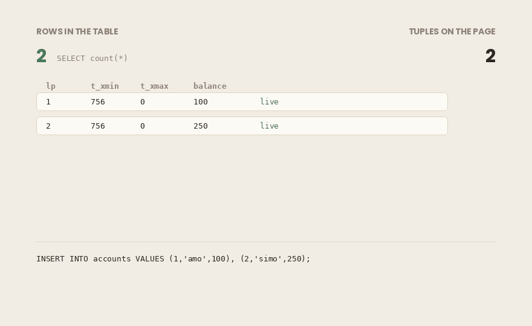
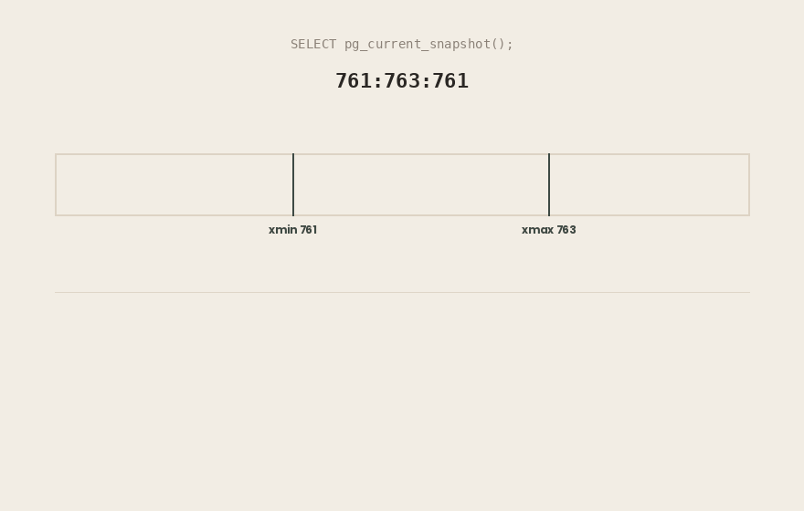
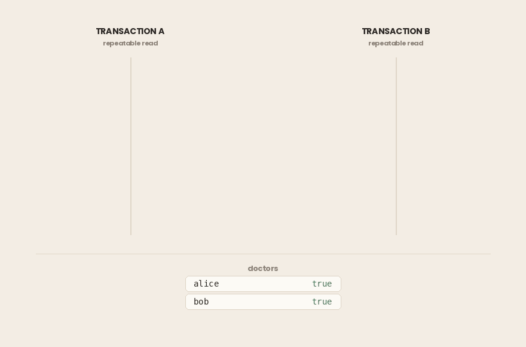
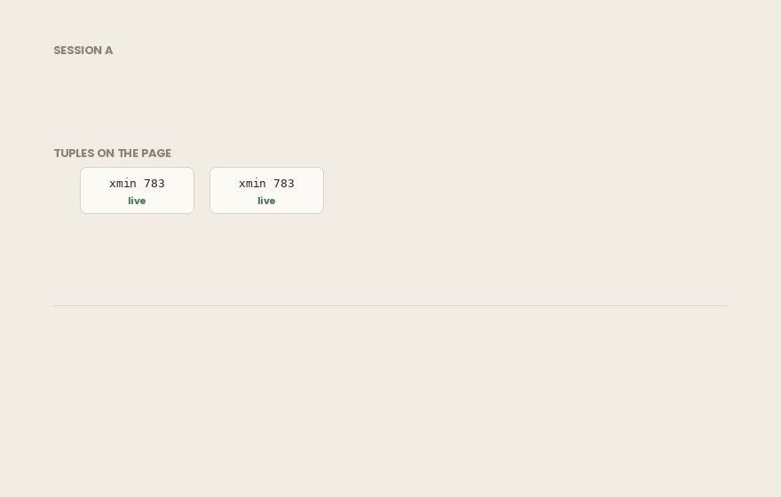

## TL;DR

- En PostgreSQL, `UPDATE` nunca cambia una fila en su sitio. Escribe una **nueva versión de la fila** y marca la antigua como muerta. `DELETE` solo marca. El número de filas de tu tabla no es el número de tuplas en disco.
- Cada tupla lleva `xmin` (la transacción que la creó) y `xmax` (la transacción que la mató o la bloqueó). Estos dos campos son el núcleo de MVCC.
- Una **instantánea** (snapshot) son tres valores: `xmin`, `xmax` y la lista de ids de transacción que seguían en ejecución cuando se tomó. La visibilidad se decide tupla a tupla frente a esa instantánea.
- Los niveles de aislamiento no son funcionalidades separadas. Son **un mismo motor con una política de instantáneas distinta**.
- **Read Committed** toma una instantánea nueva en cada sentencia. Un `UPDATE` que espera por un conflicto vuelve a comprobar después su cláusula `WHERE` contra la nueva versión.
- **Repeatable Read** congela una instantánea para toda la transacción. En PostgreSQL esto evita las lecturas sucias, las lecturas no repetibles **y las lecturas fantasma**: más de lo que exige el estándar SQL. Lo que queda son las anomalías de serialización.
- **Serializable** añade SSI: los bloqueos de predicado siguen las dependencias de lectura/escritura y abortan las transacciones que producirían un resultado no serializable. Esto es lo que atrapa el **sesgo de escritura** (write skew).
- En Repeatable Read y Serializable, `could not serialize access` no es un fallo. Forma parte del contrato, y tu aplicación **debe reintentar**, lo que hace obligatoria la idempotencia.
- Las versiones antiguas se acumulan. **VACUUM** las recupera, salvo que una transacción abierta frene el horizonte xmin; en ese caso no se puede limpiar nada.
- MVCC no es exclusivo de PostgreSQL, pero las implementaciones difieren. PostgreSQL guarda las versiones antiguas en la propia tabla; Oracle e InnoDB, en segmentos de undo. Los sistemas basados en bloqueos (2PL) bloquean a los lectores frente a los escritores; MVCC, no.

> ***Entorno de todas las salidas de este artículo:*** *PostgreSQL 18.6 (compilación de Debian) en x86_64, ejecutándose en Docker con* `autovacuum` *desactivado para que nada se limpie en segundo plano mientras lo estamos mirando. Los ids de transacción en tu máquina serán distintos; la estructura, no.*

## De las anomalías al mecanismo

En un artículo anterior describí lo que puede salir mal cuando varias transacciones se ejecutan a la vez: **lecturas sucias**, **lecturas no repetibles** y **lecturas fantasma**, y qué nivel de aislamiento evita cada una. Aquel artículo se quedó en el nivel del comportamiento: qué ves y qué ajuste lo cambia.

Este va por debajo. La pregunta aquí no es *qué anomalías evita Repeatable Read*, sino *qué hace realmente la base de datos para que sean imposibles*.

La respuesta es un único mecanismo: **el control de concurrencia multiversión** (Multiversion Concurrency Control, MVCC). Los tres niveles de aislamiento que ofrece PostgreSQL no son tres algoritmos distintos. Son el mismo motor con una regla distinta sobre cuándo se toma una instantánea.

Una corrección antes de empezar. En aquel artículo anterior escribí que hay que pasar a Serializable para evitar las lecturas fantasma. Eso es cierto en el estándar SQL. **No** lo es en PostgreSQL, y veremos exactamente por qué en cuanto el mecanismo esté sobre la mesa.

Nada de esto toca Spring, `@Transactional` ni la capa de aplicación. Dos sesiones de `psql` y una tabla.

### En resumen

- El artículo anterior describía *qué* anomalías evita cada nivel de aislamiento. Este explica *cómo*.
- Los tres niveles de aislamiento de PostgreSQL no son tres algoritmos. Son un solo motor, **MVCC**, con reglas de instantánea distintas.
- Corrección a aquel artículo: en PostgreSQL **no** necesitas Serializable para evitar las lecturas fantasma.

## UPDATE no actualiza

Empecemos con una tabla:

```sql
CREATE TABLE accounts (id int primary key, owner text, balance numeric); 

INSERT INTO accounts VALUES 
(1, 'amo', 100), 
(2, 'simo', 250);
```

Ahora cambia una fila tres veces:

```sql
UPDATE accounts SET balance = 90 WHERE id = 1; 
UPDATE accounts SET balance = 80 WHERE id = 1; 
UPDATE accounts SET balance = 70 WHERE id = 1;
```

Dos filas insertadas, tres actualizaciones aplicadas. Pregúntale a la tabla cuántas filas tiene:

```bash
visible_rows
--------------
            2
(1 row)
```

Ahora pregúntale a la *página* qué contiene. La extensión `pageinspect` lee el heap en bruto:

```sql
CREATE EXTENSION IF NOT EXISTS pageinspect; 
SELECT lp, t_xmin, t_xmax, t_ctid 
FROM heap_page_items(get_raw_page('accounts', 0));
```

```bash
 lp | t_xmin | t_xmax | t_ctid
----+--------+--------+--------
  1 |    756 |    757 | (0,3)
  2 |    756 |      0 | (0,2)
  3 |    757 |    758 | (0,4)
  4 |    758 |    759 | (0,5)
  5 |    759 |      0 | (0,5)
(5 rows)
```



Cinco tuplas en disco. Dos filas en la tabla.

Un `UPDATE` en PostgreSQL no cambia una fila. Escribe una **nueva versión** de esa fila y marca la versión antigua como muerta. `DELETE` tampoco elimina nada. Solo marca. Todas las versiones que han existido siguen en la página hasta que llega algo a limpiarlas.

Esta es la base de todo lo que sigue. Dos transacciones pueden leer la misma fila y ver valores distintos, y las dos tienen razón. No hay un único «valor actual» en disco. Hay un conjunto de versiones, y cada transacción tiene derecho a una distinta.

### En resumen

- `UPDATE` escribe una **nueva versión de la fila** y marca la antigua como muerta. `DELETE` solo marca.
- Tres actualizaciones de una fila dejan **cuatro versiones** de ella en la página. Dos filas lógicas, cinco tuplas en disco.
- No hay un único «valor actual» almacenado en ninguna parte. Hay un conjunto de versiones.
- `pageinspect` te deja ver las tuplas en bruto: `heap_page_items(get_raw_page('accounts', 0))`.

## xmin y xmax: cómo se marca una versión de fila

Cada tupla lleva dos columnas de sistema que puedes consultar directamente:

- `xmin`: el id de la transacción que creó esta versión.
- `xmax`: el id de la transacción que la marcó como muerta. `0` significa que sigue viva.

Justo después de la inserción:

```sql
SELECT xmin, xmax, ctid, * FROM accounts ORDER BY id;
```

```bash
 xmin | xmax | ctid  | id | owner | balance
------+------+-------+----+-------+---------
  756 |    0 | (0,1) |  1 | amo   |     100
  756 |    0 | (0,2) |  2 | simo  |     250
(2 rows)
```

Las dos filas las creó la transacción 756, y nada las ha matado. Tras las tres actualizaciones, la fila 1 queda así:

```bash
 xmin | xmax | ctid  | id | owner | balance
------+------+-------+----+-------+---------
  759 |    0 | (0,5) |  1 | amo   |      70
  756 |    0 | (0,2) |  2 | simo  |     250
(2 rows)
```

La fila 1 es ahora la versión creada por la transacción 759. Compárala con la salida de la página en bruto de arriba y podrás seguir la cadena: la versión 1 la mató la 757, que creó la versión 3, que mató la 758, que creó la versión 4, y así sucesivamente. `ctid` es la dirección física de una versión: número de página y número de elemento.

**Una cosa que te confundirá en el terminal.** Un `xmax` distinto de cero no siempre significa que la fila se borró o se actualizó. También se establece cuando una fila solo está **bloqueada**:

```sql
-- session B
BEGIN;
SELECT id FROM accounts WHERE id = 1 FOR UPDATE;
```

```bash
 xmin | xmax | ctid  | id | balance
------+------+-------+----+---------
  759 |  760 | (0,5) |  1 |      70
  756 |    0 | (0,2) |  2 |     250
(2 rows)
```

La transacción 760 no ha escrito nada. Tiene un bloqueo. La fila está viva y sigue viva.

La cabecera de la tupla conoce la diferencia, y te la dirá. La marca `HEAP_XMAX_LOCK_ONLY` es el bit 128 de `t_infomask`:

```sql
SELECT lp, t_xmax, (t_infomask & 128) != 0 AS xmax_is_lock_only
FROM heap_page_items(get_raw_page('accounts', 0))
WHERE lp = 5;
```

```bash
 lp | t_xmax | xmax_is_lock_only
----+--------+-------------------
  5 |    760 | t
(1 row)
```

Así que no leas `xmax` como «esta versión está muerta». Esa distinción la llevan los bits de marca, no `xmax` por sí solo.

### En resumen

- `xmin` = la transacción que creó esta versión. `xmax` = la transacción que la mató o la bloqueó; `0` significa viva.
- Las dos son columnas de sistema que puedes consultar. `ctid` es la dirección física de la versión (página, elemento).
- **Un** `xmax` **distinto de cero no significa borrada.** `SELECT ... FOR UPDATE` también lo establece. La diferencia la lleva la marca `HEAP_XMAX_LOCK_ONLY` de `t_infomask`, no `xmax` solo.

## Las instantáneas y la regla de visibilidad

Una transacción no ve la versión más reciente de una fila. Ve la versión que su **instantánea** le permite ver.

Una instantánea son tres valores, y PostgreSQL te los mostrará:

```sql
SELECT pg_current_snapshot();
```

```bash
 pg_current_snapshot
---------------------
 761:763:761
(1 row)
```

Se lee como `xmin:xmax:xip_list`:

- `xmin` **= 761**: todas las transacciones por debajo de este id han terminado. No hace falta comprobarlas una a una.
- `xmax` **= 763**: ninguna transacción de este id hacia arriba había empezado cuando se tomó la instantánea. Invisibles automáticamente.
- `xip_list` **= 761**: las transacciones entre `xmin` y `xmax` que **seguían en ejecución**. Su trabajo sigue siendo invisible aunque hagan commit un microsegundo después.

Solo el tramo central necesita una lista. Por eso `xip_list` suele estar vacía. Si todas las transacciones en ejecución tienen ids iguales o superiores a `xmax`, la segunda regla ya las excluye.



Ahora, la regla que decide cada lectura. Para que una tupla sea visible:

1. Su `xmin` **debe haber hecho commit**, y la instantánea no debe excluirlo: ni en `xip_list` ni igual o por encima de `xmax`.
2. Su `xmax` **no debe descalificarla**: o está vacío, o pertenece a una transacción que no ha hecho commit, o a una que la instantánea excluye.

Las dos condiciones, tupla a tupla, en cada lectura. Eso es toda la visibilidad de MVCC.

Falta un detalle, y es importante. Nada en la tupla dice si la transacción 757 hizo commit. La tupla guarda un id. El estado del commit vive en el **registro de commits** (commit log, `pg_xact`). Consultarlo en cada lectura sería caro, así que PostgreSQL escribe la respuesta de vuelta en la tupla como **hint bits** la primera vez que alguien pregunta. Por eso el primer `SELECT` después de una escritura puede ser más lento que el segundo sobre los mismos datos.

El mecanismo ya está completo: versiones marcadas con `xmin` y `xmax`, y una instantánea que decide cuáles se te permite ver.

Lo que no hemos dicho es **cuándo** se toma la instantánea. Esa única pregunta es la diferencia entre los niveles de aislamiento.

### En resumen

- Una instantánea son tres valores: `xmin:xmax:xip_list`. Todo lo que está por debajo de `xmin` terminó; nada de `xmax` hacia arriba había empezado; `xip_list` contiene las intermedias que seguían en ejecución.
- Una tupla es visible cuando su `xmin` **hizo commit y la instantánea no lo excluye**, **y** su `xmax` **no la descalifica**.
- `xip_list` suele estar vacía. Es normal: las transacciones en ejecución con ids iguales o superiores a `xmax` ya las excluye la segunda regla.
- El estado del commit no está en la tupla. Vive en `pg_xact`, y se guarda de vuelta como **hint bits**; por eso la primera lectura después de una escritura puede ser más lenta.

## No solo Postgres: las dos familias del control de concurrencia

Antes de ver los tres niveles de aislamiento, un paso atrás. MVCC no es un invento de PostgreSQL, y saber dónde encaja te ayuda a leer bien los niveles.

Las bases de datos resuelven el acceso concurrente de una de dos grandes maneras.

**La familia basada en bloqueos.** Con el **bloqueo en dos fases** (two-phase locking, 2PL), una transacción toma un bloqueo compartido para leer y uno exclusivo para escribir, y los mantiene hasta que termina. La regla es sencilla y el coste, alto: **un lector bloquea a un escritor, y un escritor bloquea a un lector.** La corrección se obtiene haciendo que las transacciones en conflicto se esperen unas a otras.

**La familia multiversión.** Con MVCC, una escritura no destruye lo que está usando un lector, porque la versión antigua sigue ahí. Así que **los lectores no bloquean a los escritores, y los escritores no bloquean a los lectores.** En MVCC puro, dos transacciones solo entran en conflicto cuando las dos quieren escribir la misma fila.

Esa es toda la razón por la que MVCC se impuso en las cargas OLTP. Un informe largo puede recorrer una tabla mientras siguen las actualizaciones a su alrededor, y ninguna de las dos partes espera.

Pero **MVCC es una estrategia, no una especificación**. Sistemas que dicen todos usar MVCC difieren en la parte que más importa: dónde se guardan las versiones antiguas.

- **PostgreSQL** guarda las versiones antiguas **en la propia tabla**. Es lo que viste en la página: cinco tuplas para dos filas. Barato de escribir, y la razón por la que PostgreSQL necesita **VACUUM**.
- **Oracle** y **MySQL/InnoDB** guardan las versiones antiguas en **segmentos de undo**, separados de la tabla, y reconstruyen las versiones anteriores bajo demanda. Sin VACUUM, pero una lectura larga puede sobrevivir al undo que necesita: el `ORA-01555: snapshot too old` de Oracle es exactamente ese fallo.
- **SQL Server** usa bloqueos por defecto y solo pasa a versiones cuando activas el aislamiento de instantánea.
- **CockroachDB** y **YugabyteDB** aplican MVCC en un clúster distribuido, donde las marcas de tiempo de las versiones también tienen que sobrevivir a las diferencias de reloj entre máquinas.

En el otro extremo hay una tercera respuesta: **no ejecutar transacciones a la vez en absoluto.** VoltDB las ejecuta una tras otra en particiones de un solo hilo. Correcto por diseño, y solo práctico cuando las transacciones son cortas.

Por qué importa para el resto del artículo: todo lo que viene a partir de aquí es la implementación **de PostgreSQL**. Los nombres de los niveles de aislamiento son estándar. El comportamiento que hay detrás, no.

### En resumen

- Dos familias: **basada en bloqueos (2PL)**, donde lectores y escritores se bloquean entre sí, y **multiversión (MVCC)**, donde no.
- MVCC es una estrategia, no un diseño único. Dónde viven las versiones antiguas es la principal diferencia entre implementaciones.
- PostgreSQL guarda las versiones antiguas **en la tabla**, y por eso necesita VACUUM. Oracle e InnoDB usan en su lugar **segmentos de undo**.
- Los nombres de los niveles de aislamiento del estándar SQL son comunes. El comportamiento que hay detrás depende de cada base de datos.

## Read Committed: una instantánea nueva en cada sentencia

Es el nivel por defecto de PostgreSQL, y su regla cabe en una frase: **cada sentencia toma una instantánea nueva.**

Lo que significa que dos `SELECT` idénticos en la misma transacción pueden devolver respuestas distintas.

```sql
-- session A
BEGIN ISOLATION LEVEL READ COMMITTED;
SELECT balance FROM accounts WHERE id = 1;
```

```bash
balance
---------
      70
(1 row)
```

```sql
-- session B
UPDATE accounts SET balance = 999 WHERE id = 1;
COMMIT;
```

```sql
-- session A, same transaction
SELECT balance FROM accounts WHERE id = 1;
```

```bash
balance
---------
     999
(1 row)
```

No hay nada roto. La segunda sentencia de A pidió una instantánea nueva y, para entonces, la transacción de B había hecho commit y, por tanto, era visible. Esta es la **lectura no repetible** del artículo anterior, ahora con un mecanismo detrás: no una carrera, no un fallo, sino una instantánea nueva.

**La parte que casi todos los artículos se saltan.**

Las instantáneas por sentencia explican las lecturas. Las escrituras necesitan una regla más, porque un escritor no puede ignorar sin más un cambio concurrente en la fila que está a punto de modificar.

Cuando un `UPDATE` llega a una fila que otra transacción sin commit ya ha modificado, **espera**. Si esa transacción hace rollback, la actualización sigue adelante con normalidad. Si hace commit, PostgreSQL hace algo que hay que ver para creer: **vuelve a comprobar la cláusula** `WHERE` **contra la nueva versión**.

```sql
-- balance is 1000
-- session A
BEGIN;
UPDATE accounts SET balance = 5 WHERE id = 1;   -- not committed yet
```

```sql
-- session B
BEGIN;
UPDATE accounts SET balance = balance - 100 WHERE balance > 500;
-- blocks, waiting for A
```

La sesión A hace commit. B despierta y vuelve a comprobar su condición contra la fila tal como está ahora. `balance` es 5, y `5 > 500` es falso:

```bash
UPDATE 0
```

La fila coincidía cuando B empezó y ya no coincide, así que B se la salta. **Ningún error, ningún aviso, cero filas actualizadas.** Si tu código daba por hecho que la actualización se aplicó, ahora está mal y en silencio.

Este es el argumento más fuerte a favor de cláusulas `WHERE` que no dependan de valores que también estás cambiando y, cuando la corrección importa más que el rendimiento, a favor de un nivel de aislamiento más estricto.

### En resumen

- Read Committed toma una **instantánea nueva en cada sentencia**, no en cada transacción.
- Dos `SELECT` idénticos en una transacción pueden devolver valores distintos. Es el nivel funcionando según su diseño.
- Un `UPDATE` bloqueado por una escritura concurrente **espera y luego vuelve a comprobar su cláusula** `WHERE` contra la nueva versión.
- Si la fila ya no coincide, se la salta en silencio: `UPDATE 0`, sin error.

## Repeatable Read: una instantánea para toda la transacción

Cambia una palabra y el mecanismo cambia por completo. En Repeatable Read, la instantánea se toma **una vez**, en la primera sentencia de la transacción, y nunca se renueva.

```sql
-- session A
BEGIN ISOLATION LEVEL REPEATABLE READ;
SELECT count(*) FROM accounts;           -- 2
SELECT balance FROM accounts WHERE id = 1;  -- 100
```

```sql
-- session B
INSERT INTO accounts VALUES (3, 'new', 500);
UPDATE accounts SET balance = 777 WHERE id = 1;
-- both committed
```

```sql
-- session A, same transaction
SELECT count(*) FROM accounts;
SELECT balance FROM accounts WHERE id = 1;
```

```bash
 count
-------
     2
(1 row)

 balance
---------
     100
(1 row)
```

El trabajo de B está confirmado y es permanente. A no puede verlo y no lo verá hasta que A termine. La instantánea está congelada.

**Aquí va la corrección que le debo al artículo anterior.**

Mira otra vez ese `count(*)`. B insertó una fila que coincide con la consulta de A, y el segundo recuento de A sigue devolviendo 2. Eso es una **lectura fantasma**, y no ocurrió.

En el estándar SQL, a Repeatable Read se le permite admitir lecturas fantasma, y evitarlas es tarea de Serializable. Es lo que escribí antes, y lo que repite la mayoría de los artículos. **En PostgreSQL es falso.** Aquí la visibilidad la decide una instantánea congelada, no los bloqueos de fila. Una fila creada después de la instantánea es invisible por muchas veces que mires: como fila y dentro de un agregado.

La documentación oficial es explícita: el Repeatable Read de PostgreSQL evita todos los fenómenos de la tabla del estándar salvo las anomalías de serialización. El estándar fija un **mínimo**. Dar más está permitido.

**Lo que te cuesta congelar.**

Una instantánea congelada no da problemas mientras lees. Escribir es donde se pone interesante, porque una transacción no puede modificar una versión de fila que no tiene permitido ver.

```sql
-- session A                      -- session B
BEGIN ISOLATION LEVEL REPEATABLE READ;
UPDATE accounts
  SET balance = 200 WHERE id = 1;
                                  BEGIN ISOLATION LEVEL REPEATABLE READ;
                                  UPDATE accounts
                                    SET balance = 300 WHERE id = 1;
                                  -- blocks
COMMIT;
```

```bash
ERROR:  could not serialize access due to concurrent update
```

Compáralo con Read Committed, donde B esperaba y luego aplicaba tranquilamente su actualización a la nueva versión. Repeatable Read se niega. La instantánea de B dice que `balance` es 100. La fila en disco dice otra cosa. No hay una forma honesta de seguir, así que la transacción se aborta.

**No es un fallo ni un deadlock.** Es el nivel diciéndote que no pudo cumplir su promesa y devolviendo la decisión a tu aplicación. Lo que plantea una pregunta que tendremos que responder como es debido: ¿qué se supone que tiene que hacer tu código con ese error?

### En resumen

- Repeatable Read toma **una instantánea** en la primera sentencia y la mantiene durante toda la transacción.
- Los cambios confirmados de otras transacciones siguen siendo invisibles hasta que la tuya termina.
- **El Repeatable Read de PostgreSQL también evita las lecturas fantasma**: más de lo que exige el estándar SQL. Solo quedan las anomalías de serialización.
- Una escritura en conflicto no espera y reintenta. Falla con `could not serialize access due to concurrent update`.

## Serializable: cuando las instantáneas no bastan

Una instantánea congelada evita todas las anomalías basadas en *leer la versión equivocada*. Hay una clase de fallo que no puede tocar, porque no se lee nada mal.

Dos médicos están de guardia. La regla: al menos uno tiene que quedarse.

```sql
CREATE TABLE doctors (name text primary key, on_call boolean);
INSERT INTO doctors VALUES ('alice', true), ('bob', true);
```

Los dos quieren irse a casa, al mismo tiempo, con **Repeatable Read**:

```sql
-- session A                        -- session B
BEGIN ISOLATION LEVEL REPEATABLE READ;
SELECT count(*) FROM doctors
  WHERE on_call;              -- 2
                                    BEGIN ISOLATION LEVEL REPEATABLE READ;
                                    SELECT count(*) FROM doctors
                                      WHERE on_call;              -- 2
UPDATE doctors SET on_call = false
  WHERE name = 'alice';
                                    UPDATE doctors SET on_call = false
                                      WHERE name = 'bob';
COMMIT;
                                    COMMIT;
```

Las dos hacen commit. Ningún error. Ahora mira la tabla:

```bash
name  | on_call
-------+---------
 alice | f
 bob   | f
(2 rows)
```

No queda nadie de guardia.



**Cada paso era legal.** Cada transacción leyó una instantánea correcta, comprobó la regla, vio dos médicos y quitó uno. Escribieron en **filas distintas**, así que no hubo ningún conflicto de escritura que MVCC pudiera detectar. Cada transacción es correcta por sí sola, y la pareja no lo es.

Esto es el **sesgo de escritura** (write skew), y es la anomalía que el aislamiento de instantánea no puede ver. La razón es estructural. MVCC detecta conflictos entre **escrituras**. Aquí el conflicto está entre lo que una transacción **leyó** y lo que la otra **escribió**.

`SELECT ... FOR UPDATE` arreglaría este caso concreto bloqueando las filas leídas. Pero eso exige que detectes antes el problema, en cada lugar donde puede ocurrir.

**Lo que añade Serializable.**

El Serializable de PostgreSQL usa **SSI, Serializable Snapshot Isolation** (aislamiento de instantánea serializable). Mantiene la maquinaria de instantáneas y añade un seguimiento encima. Cuando una transacción lee, PostgreSQL registra lo que leyó, incluidas las condiciones y no solo las filas. Ese registro es un **bloqueo de predicado**, que se mantiene como un bloqueo `SIREAD`, y no bloquea nada.

Con esa información, PostgreSQL vigila las **dependencias de lectura/escritura**: la transacción B escribió algo que A había leído. Una dependencia así es inofensiva. Un patrón concreto de ellas, con una transacción situada entre otras dos de una forma que ningún orden en serie podría producir, no lo es. Cuando PostgreSQL ve ese patrón, aborta una de las transacciones.

El mismo escenario, cambiando una palabra:

```sql
BEGIN ISOLATION LEVEL SERIALIZABLE;
```

```bash
ERROR:  could not serialize access due to read/write dependencies among transactions
DETAIL:  Reason code: Canceled on identification as a pivot, during commit attempt.
HINT:  The transaction might succeed if retried.
```

Lee ese error con atención. No habla de la fila que escribió B. Habla de la **dependencia entre lo que leyó B y lo que escribió A**: un conflicto sin bloqueos, sin esperas y sin bloquear nada en toda la secuencia. La base de datos dejó que las dos transacciones se ejecutaran a toda velocidad y solo se negó al final, cuando pudo demostrar que el resultado no era serializable.

Fíjate en la palabra **pivot** (pivote). B es la transacción que está en medio del patrón peligroso, y PostgreSQL cancela el pivote en lugar del primer o el último participante.

Y la regla sobrevive:

```bash
name  | on_call
-------+---------
 alice | f
 bob   | t
(2 rows)
```

Alice se fue a casa. A Bob se le hizo rollback y sigue de guardia. Las mismas dos transacciones, el mismo orden, una palabra clave distinta.

Serializable no es gratis. Seguir las lecturas cuesta memoria y, con contención, produce más abortos. Pero te da una garantía que ningún otro nivel te da: **si tu transacción es correcta cuando se ejecuta sola, es correcta cuando se ejecuta junto a otras.** Dejas de razonar sobre intercalaciones.

Viene con una condición, y no es opcional. Ese `HINT` dice que la transacción podría tener éxito si se reintenta, lo que significa que alguien tiene que reintentarla.

### En resumen

- Repeatable Read evita las anomalías causadas por leer una versión obsoleta. **El sesgo de escritura no es una de ellas.**
- Dos transacciones pueden leer la misma condición, escribir **filas distintas**, hacer commit las dos y romper juntas un invariante.
- MVCC detecta conflictos de **escritura/escritura**. El sesgo de escritura es un conflicto de **lectura/escritura**, invisible para él.
- Serializable añade **SSI**: los bloqueos de predicado registran lo que se leyó, y los patrones de dependencia peligrosos provocan un aborto en el momento del commit.
- El aborto es el mecanismo funcionando, no fallando, y da por hecho que tu aplicación reintenta.

## Tienes que reintentar. No hay forma de evitarlo.

Los dos niveles de aislamiento más estrictos pueden terminar tu transacción con un error que no has causado tú:

```bash
ERROR:  could not serialize access due to concurrent update
ERROR:  could not serialize access due to read/write dependencies among transactions
HINT:  The transaction might succeed if retried.
```

Tratarlos como fallos es el error más común con Repeatable Read y Serializable. **No son fallos. Forman parte del contrato.**

El trato que ofrece PostgreSQL es este: ejecutar a toda velocidad, sin bloqueos, y a cambio aceptar que a algunas transacciones se les diga que empiecen de nuevo. No puedes quedarte con la primera mitad sin la segunda. Un sistema que usa Serializable y no reintenta ha asumido el coste y ha rechazado el beneficio.

**Qué errores reintentar.**

Reintenta solo ante **SQLSTATE 40001** (`serialization_failure`) y **40P01** (`deadlock_detected`). En la práctica, los dos significan lo mismo: no se escribió nada, la transacción hizo un rollback limpio y volver a ejecutarla puede funcionar.

No reintentes ante violaciones de restricciones, errores de sintaxis ni fallos de conexión. Esos volverán a fallar.

```java
int attempt = 0;
while (true) {
    try {
        return doTransaction();
    } catch (SQLException e) {
        String state = e.getSQLState();
        if (!("40001".equals(state) 
        || "40P01".equals(state)) 
        || ++attempt >= MAX) {
            throw e;
        }
        Thread.sleep(backoffWithJitter(attempt));
    }
}
```

En ese bucle importan tres detalles.

**El reintento tiene que estar fuera de la transacción.** Una transacción con rollback no se puede reanudar. Todo lo que hizo la transacción, incluido cualquier cambio que tu aplicación hiciera en memoria, hay que rehacerlo desde el principio.

**Espera antes de reintentar, y añade jitter.** Dos transacciones que entraron en conflicto una vez volverán a hacerlo si las dos reintentan de inmediato. Sin una variación aleatoria (jitter), los reintentos se alinean y la contención empeora.

**Limita los intentos.** Un bucle de reintentos infinito convierte un conflicto temporal en una caída del servicio.

**La parte en la que es fácil equivocarse.**

Reintentar significa que el cuerpo de la transacción puede ejecutarse más de una vez. Eso es seguro para el trabajo en la base de datos, porque el rollback lo deshizo. No es seguro para nada más que haga tu código dentro de ese bloque.

Enviar un correo, llamar a una API de pagos, publicar en Kafka, escribir un archivo, incrementar un contador en memoria: PostgreSQL no hace rollback de nada de eso. Reintenta la transacción tres veces y puede que cobres tres veces a un cliente.

Así que la regla es: **el cuerpo de la transacción debe ser idempotente, o no debe contener nada más que trabajo en la base de datos.** Los efectos secundarios van fuera del límite del reintento, o detrás de una clave de idempotencia, o en una tabla outbox escrita dentro de la misma transacción y procesada después.

**Read Committed no te libra.** Evita los fallos de serialización en las lecturas, pero un deadlock entre dos transacciones que toman bloqueos en distinto orden puede producirse en cualquier nivel de aislamiento, y eso es `40P01`. La lógica de reintento no es algo exclusivo de Serializable.

### En resumen

- `40001` y `40P01` son **resultados esperados**, no fallos. Significan que la transacción hizo un rollback limpio y puede volver a ejecutarse.
- Reintenta solo esos dos SQLSTATE. Las violaciones de restricciones y los errores de sintaxis volverán a fallar.
- El reintento debe envolver **toda** la transacción, con espera, **jitter** y un número máximo de intentos.
- El cuerpo de la transacción se ejecutará más de una vez. Los efectos secundarios que no son de la base de datos (correos, pagos, publicación de mensajes) deben ser **idempotentes** o salir del límite del reintento.

## La factura: tuplas muertas, hinchazón y VACUUM

La ventaja de MVCC es que los escritores nunca bloquean a los lectores. El precio es que cada actualización deja un cadáver, y alguien tiene que enterrarlo.

Ese alguien es **VACUUM**.

Cincuenta mil filas, actualizadas una vez:

```sql
CREATE TABLE bloat (id int primary key, v int);
INSERT INTO bloat SELECT g, g FROM generate_series(1, 50000) g;
UPDATE bloat SET v = v + 1;
```

```sql
SELECT n_live_tup, n_dead_tup FROM pg_stat_user_tables WHERE relname = 'bloat';
```

```bash
n_live_tup | n_dead_tup
------------+------------
      50000 |      50000
(1 row)
```

Cincuenta mil filas vivas, cincuenta mil versiones muertas, todas en la misma tabla. Esto es la **hinchazón** (bloat): páginas que tus consultas todavía tienen que recorrer y disco que sigues pagando.

Si esa consulta devuelve ceros al principio, espera un segundo y vuelve a ejecutarla. Las estadísticas de las tablas se vuelcan con un pequeño retraso, no en cada escritura.

VACUUM encuentra esas tuplas muertas y marca su espacio como reutilizable. **Autovacuum** lo hace en segundo plano. Por defecto, empieza cuando el número de tuplas muertas supera el 20 % de la tabla más 50 filas.

**El fallo con el que de verdad te vas a encontrar.**

VACUUM no puede eliminar una tupla muerta que alguna transacción abierta podría seguir necesitando. La transacción más antigua del sistema fija un suelo, el **horizonte xmin** (xmin horizon), y no se puede limpiar nada por encima de él.

Abre una transacción, toma una instantánea y luego actualiza todas las filas desde otro sitio:

```sql
-- session A
BEGIN ISOLATION LEVEL REPEATABLE READ;
SELECT count(*) FROM bloat;    -- snapshot taken here
-- and then A just sits there
```

```sql
-- elsewhere
UPDATE bloat SET v = v + 1;
VACUUM (VERBOSE) bloat;
```

```bash
INFO:  vacuuming "mvcc.public.bloat"
INFO:  finished vacuuming "mvcc.public.bloat": index scans: 1
pages: 0 removed, 664 remain, 664 scanned (100.00% of total), 0 eagerly scanned
tuples: 0 removed, 100000 remain, 50000 are dead but not yet removable
removable cutoff: 784, which was 1 XIDs old when operation ended
```

**Cero eliminadas.** Hay cincuenta mil tuplas muertas, VACUUM las encontró todas y no tiene permitido tocar ni una, porque la instantánea de la sesión A podría seguir necesitándolas.



Puedes ver quién está reteniendo la línea:

```sql
SELECT pid, backend_xid, backend_xmin, now() - xact_start AS age
FROM pg_stat_activity
WHERE backend_xid IS NOT NULL OR backend_xmin IS NOT NULL;
```

```bash
pid | backend_xid | backend_xmin |       age
-----+-------------+--------------+-----------------
 521 |             |          785 | 00:00:00
 552 |             |          784 | 00:00:36.095027
(2 rows)
```

La segunda fila es la culpable: abierta desde hace treinta y seis segundos, con `backend_xmin` retenido en 784, que es exactamente el límite que acaba de informar VACUUM.

Cierra esa transacción y vuelve a ejecutar VACUUM:

```bash
tuples: 50000 removed, 66642 remain, 0 are dead but not yet removable
removable cutoff: 785, which was 0 XIDs old when operation ended
```

No ha cambiado nada, salvo que ha terminado una sesión.

**Qué transacciones abiertas bloquean de verdad la limpieza.** No todas, y conviene conocer la diferencia antes de salir a buscarlas.

- Una transacción en **Repeatable Read o Serializable** mantiene su instantánea desde la primera sentencia hasta que termina. Aparece en `backend_xmin`, y bloquea la limpieza mientras está abierta, incluso inactiva.
- Una transacción en **Read Committed** que ha **escrito** algo mantiene un id de transacción abierto. Aparece en `backend_xid`, y VACUUM no puede mover su límite más allá de él, así que también bloquea la limpieza. Basta un `UPDATE` en una sesión por lo demás inactiva:

```bash
-- while that session is open
tuples: 0 removed, 39999 remain, 19999 are dead but not yet removable

-- after it commits
tuples: 20000 removed, 20000 remain, 0 are dead but not yet removable
```

- Una transacción en **Read Committed** que solo ha **leído** no mantiene una instantánea entre sentencias. Una así, inactiva, no bloquea la limpieza. Sigue mereciendo la pena cerrarla, pero no es lo que está hinchando tus tablas.

Así que el patrón peligroso es preciso: una transacción larga o inactiva que usa un nivel de aislamiento más estricto o que ya ha escrito. Una sesión así congela el horizonte para **toda la base de datos**, y la tabla que se hincha puede no tener nada que ver con la consulta que está atascada.

Configura `idle_in_transaction_session_timeout`. Vigila `backend_xid` y `backend_xmin` en `pg_stat_activity`. Y ten en cuenta que Repeatable Read y Serializable lo empeoran por diseño: mantienen una instantánea durante toda la transacción, así que una lenta cuesta más de lo que costaría en Read Committed.

**Una cosa que VACUUM no hace.** Acaba de eliminar cincuenta mil tuplas muertas. Ahora mira el archivo:

```sql
SELECT pg_size_pretty(pg_relation_size('bloat')) AS before_full;
VACUUM FULL bloat;
SELECT pg_size_pretty(pg_relation_size('bloat')) AS after_full;
```

```bash
before_full
-------------
 5312 kB

 after_full
------------
 1776 kB
```

El VACUUM normal hizo el espacio **reutilizable por esa tabla** y dejó el archivo en 5312 kB. `VACUUM FULL` reescribió la tabla y devolvió dos tercios del disco. La pega está en cómo lo hace: toma un bloqueo exclusivo y bloquea todo lo demás sobre la tabla durante toda la reescritura. En una tabla grande de producción, eso es una caída del servicio, y por eso existe `pg_repack`.

### En resumen

- Cada actualización deja una tupla muerta. **VACUUM** recupera ese espacio; **autovacuum** lo hace automáticamente.
- VACUUM no puede eliminar tuplas que alguna transacción abierta podría seguir necesitando. La más antigua fija el **horizonte xmin**.
- Las transacciones en Repeatable Read y Serializable bloquean la limpieza mientras están abiertas. También las de Read Committed que han escrito. Una sesión de Read Committed inactiva que solo ha leído, no.
- Una sola transacción así puede detener la limpieza **en toda la base de datos**, en tablas que nunca tocó.
- Usa `idle_in_transaction_session_timeout` y vigila `backend_xid` y `backend_xmin` en `pg_stat_activity`.
- El VACUUM normal hace el espacio reutilizable, pero **no** encoge el archivo (5312 kB antes y después). `VACUUM FULL` sí, y toma un bloqueo exclusivo mientras trabaja.

## Elegir un nivel: una lista de comprobación

El mecanismo ya está sobre la mesa. Elegir un nivel se reduce a responder con honestidad unas pocas preguntas.

**1. ¿Alguna transacción lee un valor y luego escribe en función de él?**

Si es así, Read Committed es peligroso. Esto incluye `UPDATE ... SET x = x - 100`, las comprobaciones de reservas, las de saldo y las de «¿esto ya existe?». Recuerda el `UPDATE 0` de antes: la fila dejó de coincidir en silencio y nada te avisó.

Si no, si solo escribes valores independientes y lees para mostrar, Read Committed está bien y es más barato.

**2. ¿La corrección depende de una regla que abarca varias filas?**

«Al menos un médico de guardia.» «La suma de estos saldos no debe ser negativa.» «No puede haber dos reservas que se solapen.»

El aislamiento de instantánea no puede proteger esto. Es el **sesgo de escritura**, y la respuesta es Serializable, o bloqueos explícitos, o una restricción de la base de datos que imponga la regla directamente.

**3. ¿Un informe necesita una vista consistente a lo largo de muchas consultas?**

Repeatable Read. Una instantánea, un solo momento en el tiempo, todas las sentencias de acuerdo entre sí. Vigila cuánto dura la transacción: un informe lento retiene el horizonte xmin.

**4. ¿Tu aplicación puede reintentar?**

Si la respuesta es no, no puedes usar Repeatable Read ni Serializable con seguridad. La solución honesta es hacer posible el reintento, no bajar a un nivel más débil y cruzar los dedos.

**5. ¿Qué pasa si te mudas a otra base de datos?**

Los nombres son estándar. El comportamiento, no. El Repeatable Read de PostgreSQL evita las lecturas fantasma con una instantánea congelada. InnoDB llega a un resultado parecido para los `SELECT` corrientes con su propia instantánea, pero sus lecturas con bloqueo (`SELECT ... FOR UPDATE`, `UPDATE`, `DELETE`) leen en cambio los últimos datos confirmados y se apoyan en bloqueos de hueco (gap locks), así que el comportamiento difiere justo donde estás escribiendo. Serializable en PostgreSQL usa SSI y aborta transacciones; otros sistemas usan bloqueos y las bloquean: la misma garantía, un modo de fallo completamente distinto.

**Si tu código tiene que ejecutarse en más de un motor, no confíes en que el nombre de un nivel de aislamiento transmita un significado.** Confía en bloqueos explícitos, restricciones o comprobaciones en la aplicación.

**Un valor por defecto que merece la pena.** Empieza en Read Committed. Pasa a Serializable las transacciones concretas que llevan una regla que no puedes romper, y mantenlas cortas. El nivel de aislamiento es un ajuste por transacción, no de toda la aplicación.

**Hacia dónde va esto.** Todo lo de aquí decide lo que una transacción *tiene permitido ver*. A veces eso no basta. A veces necesitas reservar una fila antes de tocarla y decirles a las demás transacciones que esperen. Eso es el bloqueo explícito: `SELECT ... FOR UPDATE`, los bloqueos consultivos y los deadlocks que vienen con ellos. Ese es el próximo artículo.

## Referencias

**Documentación de PostgreSQL**

- *Chapter 13: Concurrency Control*
 [https://www.postgresql.org/docs/current/mvcc.html](https://www.postgresql.org/docs/current/mvcc.html)
- *13.2 Transaction Isolation*
 [https://www.postgresql.org/docs/current/transaction-iso.html](https://www.postgresql.org/docs/current/transaction-iso.html)
- *Routine Vacuuming*
 [https://www.postgresql.org/docs/current/routine-vacuuming.html](https://www.postgresql.org/docs/current/routine-vacuuming.html)
- *System Columns* 
 [https://www.postgresql.org/docs/current/ddl-system-columns.html](https://www.postgresql.org/docs/current/ddl-system-columns.html)
- *pageinspect* 
 [https://www.postgresql.org/docs/current/pageinspect.html](https://www.postgresql.org/docs/current/pageinspect.html)
- *Transaction ID and Snapshot Information Functions*
 [https://www.postgresql.org/docs/current/functions-info.html](https://www.postgresql.org/docs/current/functions-info.html)
- *The Statistics Collector*
 [https://www.postgresql.org/docs/current/monitoring-stats.html](https://www.postgresql.org/docs/current/monitoring-stats.html)

**Otros motores**

- MySQL Reference Manual, *Transaction Isolation Levels* 
 [https://dev.mysql.com/doc/refman/8.4/en/innodb-transaction-isolation-levels.html](https://dev.mysql.com/doc/refman/8.4/en/innodb-transaction-isolation-levels.html)

**Lecturas de fondo**

- Hironobu Suzuki, *The Internals of PostgreSQL*
 [https://www.interdb.jp/pg/](https://www.interdb.jp/pg/)
- PostgreSQL Wiki, *Serializable Snapshot Isolation (SSI)* 
 [https://wiki.postgresql.org/wiki/SSI](https://wiki.postgresql.org/wiki/SSI)
- Michael J. Cahill, Uwe Röhm, Alan D. Fekete, *Serializable Isolation for Snapshot Databases* (SIGMOD 2008)
 [https://dl.acm.org/doi/10.1145/1376616.1376690](https://dl.acm.org/doi/10.1145/1376616.1376690)
- Martin Kleppmann, *Designing Data-Intensive Applications*, capítulo 7

**Artículo anterior**

- [*Database Transactions and Spring’s Way of Managing Them* ](https://medium.com/havelsan/database-transactions-and-springs-way-of-managing-them-1ae30b8e6c5c?sharedUserId=mr-yakar): las anomalías descritas en el nivel del comportamiento, y la afirmación sobre las lecturas fantasma que se corrige aquí.
