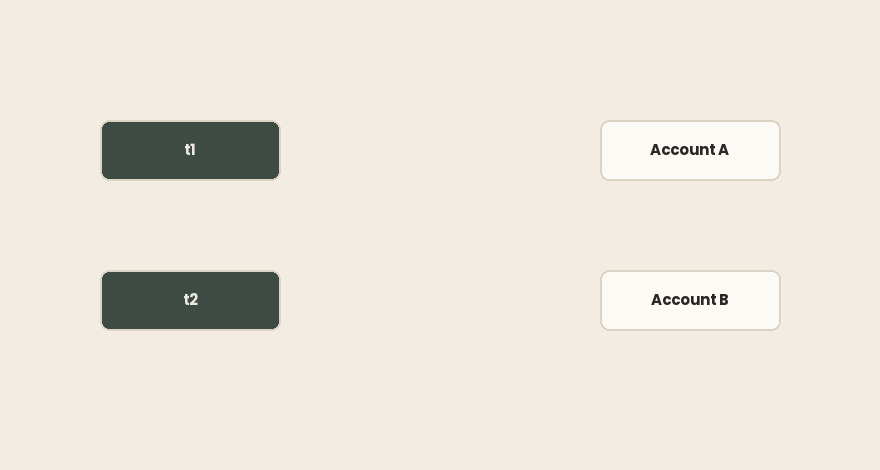
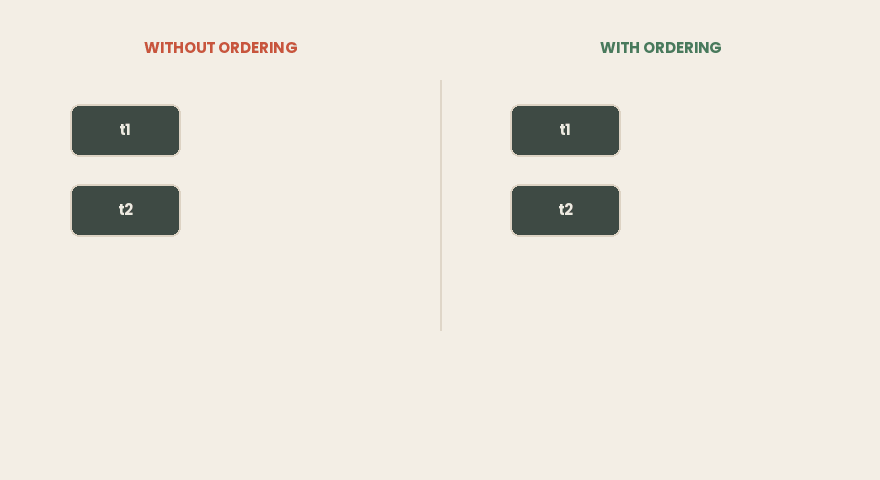

## TL;DR

- `synchronized` y `ReentrantLock` te dan exclusión mutua y una arista happens-before. Ninguno evita el deadlock.
- `ReentrantLock` añade `tryLock`, tiempos de espera, espera interrumpible, equidad y varias `Condition`. El precio es un `try/finally` obligatorio y un `unlock()` que puedes olvidar.
- `jstack` detecta los deadlocks en ambos, pero los imprime de forma distinta: `waiting to lock monitor` para `synchronized`, `waiting for ownable synchronizer` para `ReentrantLock`.
- Sin `-l`, la sección `Locked ownable synchronizers` desaparece por completo. Pasa siempre `-l`.
- **Un monitor más el bloqueo de lectura de un** `ReadWriteLock` **pueden caer en deadlock sin que la JVM informe de nada.** Los dos hilos se cuelgan y el volcado no dice nada, porque un bloqueo de lectura es compartido y no tiene un único propietario con el que construir un ciclo.
- Cuatro condiciones producen un deadlock. En Java solo se pueden romper dos: la espera circular (ordenación de bloqueos) y la retención y espera (`tryLock` más retroceso).
- Con la ordenación de bloqueos, la demo de abajo termina en 20 ms. `tryLock` con retroceso necesita 320–640 ms para una quinta parte del trabajo. Ordena los bloqueos si puedes.
- **Los hilos virtuales nunca aparecen en la salida de** `jstack`, y nada informa de un deadlock entre ellos.
- Los JDK 21–23 anclaban (pinning) los hilos virtuales dentro de `synchronized`. La JEP 491 lo arregló en el JDK 24 y eliminó la opción `jdk.tracePinnedThreads`, que ahora falla en silencio. Los consejos escritos antes de eso están desfasados.

> ***Entorno de todas las salidas siguientes:***
>
> - *Intel Core i7–4700HQ (4 núcleos / 8 hilos, x86–64)*
>
> - *Ubuntu 26.04*
>
> - *Amazon Corretto 21.0.11*
>
> - *Amazon Corretto 25.0.4.*
>
> **Todas las salidas siguientes proceden de seis programas de un solo archivo.**
>
> *Sin herramienta de compilación, sin dependencias:* `javac *.java` *y a ejecutar.*
>
> *Las secciones de volcados necesitan dos terminales: el programa en una,* `jcmd -l` *y* `jstack -l <pid>` *en la otra.*
>
> *Código: [*[*github.com/…*](https://github.com/mryakar/article-examples/tree/master/synchronized-vs-reentrantlock)*]*

## Una transferencia que nunca termina

Dos cuentas, dos hilos, dinero moviéndose en ambas direcciones.

```java
static void transfer(Account from, Account to, double amount) {
    synchronized (from) {
        synchronized (to) {
            from.balance -= amount;
            to.balance += amount;
        }
    }
}
```

`t1` transfiere de A → B cien mil veces. `t2` transfiere de B → A el mismo número de veces. El método bloquea las dos cuentas, así que no se pierde ninguna actualización. La aritmética es correcta.

Ejecútalo cinco veces:

```bash

$ for i in 1 2 3 4 5; do timeout 15 java Transfer.java; echo "-- exit $?"; done
-- exit 124
-- exit 124
-- exit 124
-- exit 124
-- exit 124
```

`124` es el código de salida de `timeout`. El programa no terminó nunca, cinco de cinco veces. Ninguna excepción, ningún error, ninguna salida: el proceso simplemente deja de avanzar y sigue vivo hasta que lo matas.

Cada hilo, por separado, es correcto. Juntos se detienen.

### En resumen

- Bloquear las dos cuentas hace que cada transferencia sea atómica y que los saldos sean correctos.
- Aun así, el programa se cuelga, de forma fiable, sin ningún tipo de error.
- Que el código de cada hilo sea correcto no suma un programa correcto.

## Lo que `synchronized` ya te da

Todo objeto de Java tiene un **monitor**. `synchronized` lo adquiere: el de `this` en un método de instancia, el del objeto `Class` en un método estático, el del objeto que nombres en un bloque.

Es **reentrante**. Un hilo que ya tiene el monitor puede volver a entrar; la JVM lleva un contador y lo libera al llegar a cero. Sin esto, un método `synchronized` que llamara a otro sobre el mismo objeto caería en deadlock consigo mismo.

Y te da más que exclusión. Según las reglas de happens-before: *el desbloqueo de un monitor ocurre antes (happens-before) que cualquier bloqueo posterior de ese mismo monitor*. Así que `synchronized` también publica todo lo que hizo el hilo antes de liberarlo. Exclusión y visibilidad, con una sola palabra clave.

### En resumen

- `synchronized` bloquea el monitor de un objeto: `this`, el objeto `Class` o un objeto con nombre.
- Es reentrante, así que las llamadas anidadas sobre el mismo objeto no se bloquean a sí mismas.
- El desbloqueo ocurre antes (happens-before) que el siguiente bloqueo, así que proporciona **visibilidad** además de exclusión.

## Lo que no te da

`ReentrantLock` ofrece las mismas garantías y añade cinco cosas que `synchronized` no puede expresar.

`tryLock()` devuelve `false` de inmediato en lugar de esperar. `tryLock(timeout, unit)` espera un tiempo acotado. Juntos permiten que un hilo se rinda, que es toda la estrategia contra el deadlock de una sección posterior.

`lockInterruptibly()` permite que un hilo en espera responda a `interrupt()`. Un hilo bloqueado en `synchronized` no puede interrumpirse en absoluto; tu señal de apagado simplemente se ignora.

**Equidad.** `new ReentrantLock(true)` entrega el bloqueo a quien lleva más tiempo esperando. Elimina la inanición y cuesta rendimiento, porque anula el adelantamiento (barging) que hace rápido el camino no equitativo. Por defecto, no equitativo.

**Varias** `Condition`**.** `wait`/`notify` da una cola por objeto, así que `notifyAll` despierta por igual a productores y consumidores. Un bloqueo puede crear objetos `Condition` separados y despertar solo al grupo que puede avanzar.

**Bloqueo no estructurado en bloques.** `synchronized` libera en la llave de cierre. Un bloqueo puede adquirirse en un método y liberarse en otro: la base del recorrido mano sobre mano (hand-over-hand).

### En resumen

- `tryLock` y `tryLock(timeout)` permiten que un hilo deje de esperar.
- `lockInterruptibly` hace cancelable a un hilo en espera; `synchronized`, no.
- La equidad evita la inanición y cuesta rendimiento. Varias `Condition` despiertan solo a los que esperan lo adecuado.
- Un bloqueo puede liberarse fuera del bloque en el que se tomó.

## El precio de pedir más

`synchronized` libera el monitor en la llave de cierre, también cuando una excepción desenrolla la pila. No hay forma de dejarlo escapar.

`ReentrantLock` no tiene llave de cierre, así que escribes tú mismo la liberación:

```java
lock.lock();
try {
    // critical section
} finally {
    lock.unlock();
}
```

Aquí es fácil cometer dos errores. Poner `lock()` **dentro** del `try` significa que una excepción de `lock()` lleva a desbloquear un bloqueo que nunca adquiriste: `IllegalMonitorStateException`, que enmascara el error original. Olvidar el `finally` significa que una sola excepción en un camino poco frecuente deja escapar el bloqueo para siempre, y todos los hilos posteriores se bloquean eternamente en algo que ya retornó.

Este es el argumento a favor de `synchronized` como opción por defecto. No que los bloqueos sean lentos, sino que la versión segura de un bloqueo son cuatro líneas de ceremonia que tienes que escribir bien cada vez.

### En resumen

- `synchronized` siempre libera, también ante excepciones.
- `ReentrantLock` exige `lock()` antes del `try` y `unlock()` en el `finally`.
- Un bloqueo que se escapa no falla de forma ruidosa. Los hilos posteriores se bloquean para siempre.
- Prefiere `synchronized` a menos que necesites algo de la sección anterior.

## Leer el volcado

El programa colgado sigue en ejecución, así que haz un volcado de hilos (thread dump). Busca el proceso con `jcmd -l` y luego:

```bash
jstack <pid>
```

Al final de la salida:

```bash
Found one Java-level deadlock:
=============================
"t1":
  waiting to lock monitor 0x00007ccf68000f80 (object 0x00000007242a2088, a Transfer$Account),
  which is held by "t2"
"t2":
  waiting to lock monitor 0x00007ccf5c000f60 (object 0x00000007242a2070, a Transfer$Account),
  which is held by "t1"
```

La JVM encontró el ciclo, nombró los dos hilos y los dos objetos, e imprimió las pilas para que puedas encontrar las líneas.



Ahora el mismo deadlock, construido con `ReentrantLock`:

```bash
"t1":
  waiting for ownable synchronizer 0x00000007253a3308,
  (a java.util.concurrent.locks.ReentrantLock$NonfairSync),
  which is held by "t2"
```

El mismo ciclo, otras palabras. Un monitor está *locked*; un `ReentrantLock` es un **ownable synchronizer**. Si buscas `waiting to lock` en los volcados de hilos, se te escaparán todos los deadlocks de `java.util.concurrent` de tu sistema.

Una diferencia más, y evitarla no cuesta nada:

```bash
--- without -l: 0
--- with    -l: 14
```

Es el número de líneas `Locked ownable synchronizers`. Sin `-l`, el volcado enumera qué monitores tiene cada hilo, pero no dice nada de qué bloqueos tiene. La sección del deadlock sigue apareciendo, pero la contención que todavía no se ha convertido en deadlock es invisible. Haz de `-l` una costumbre.

### En resumen

- La JVM detecta los deadlocks y los imprime al final del volcado. No los resuelve.
- `synchronized` aparece como `waiting to lock monitor`; `ReentrantLock`, como `waiting for ownable synchronizer`.
- Buscar en los volcados solo una de esas frases oculta la mitad de tus deadlocks.
- Usa siempre `jstack -l`, o `jcmd <pid> Thread.print -l`.

## Los deadlocks de los que la JVM no te avisará

La sección anterior termina en una nota cómoda: haz un volcado, lee la sección, arregla el código. Aquí es donde eso deja de funcionar.

Un hilo toma un monitor y después un bloqueo de escritura. Otro toma un bloqueo de **lectura** y después el mismo monitor:

```java
// t1
synchronized (MON) { RW.writeLock().lock(); }
// t2
RW.readLock().lock(); synchronized (MON) { }
```

Los dos hilos se cuelgan. El volcado muestra exactamente por qué:

```bash
"t1" ... java.lang.Thread.State: WAITING (parking)
    - parking to wait for <0x...> (a ReentrantReadWriteLock$NonfairSync)
"t2" ... java.lang.Thread.State: BLOCKED (on object monitor)
    - waiting to lock <0x...> (a java.lang.Object)
```

Y luego:

```bash
=== deadlock reported? ===
NO DEADLOCK SECTION
=== still stuck? threads alive: 2
```

Diez segundos después, los dos hilos siguen ahí. Es un deadlock real, y `jstack -l` no dice nada de él.


La detección de deadlocks funciona construyendo un grafo de *quién tiene qué* y buscando un ciclo. Un monitor tiene exactamente un propietario. Un `ReentrantLock` exclusivo tiene exactamente un propietario. Un **bloqueo de lectura no**: es compartido por diseño, lo tienen cualquier número de hilos a la vez, y la JVM no puede nombrar el hilo detrás del cual estás esperando. Falta la arista, así que el ciclo nunca se encuentra.

La regla práctica: si en un cuelgue interviene un `ReadWriteLock`, un `Semaphore`, un `CountDownLatch` o cualquier otra construcción de permisos compartidos, no te fíes de la ausencia de una sección de deadlock. Lee tú mismo los estados de los hilos. Un `WAITING (parking)` más un `BLOCKED (on object monitor)` que persisten en dos volcados tomados con un minuto de diferencia son un deadlock, diga lo que diga la herramienta.

### En resumen

- Un monitor combinado con un bloqueo de lectura puede caer en deadlock **sin sección de deadlock en el volcado**.
- La detección necesita un único propietario por recurso. Los bloqueos compartidos no lo tienen, así que el ciclo no se puede construir.
- El mismo hueco se aplica a semáforos, latches y otras construcciones basadas en permisos.
- Compara dos volcados con un minuto de diferencia. Los hilos atascados en el mismo marco están atascados, se informe o no.

## Cuatro condiciones, y cuál puedes romper

Un deadlock necesita las cuatro condiciones de [**Coffman**](https://en.wikipedia.org/wiki/Deadlock_%28computer_science%29) a la vez. Elimina cualquiera de ellas y no puede formarse.

**Exclusión mutua**: el recurso no se puede compartir. Para eso sirve un bloqueo. No se puede romper.

**Sin expropiación**: nada le quita el bloqueo a quien lo tiene. La JVM nunca lo hace y no hay ninguna API para ello. No se puede romper.

**Retención y espera**: un hilo que tiene un bloqueo espera otro. Se puede romper: adquiere todo a la vez o libera lo que tienes cuando no puedes conseguir el resto.

**Espera circular**: el grafo de espera forma un ciclo. Se puede romper: haz que todos los hilos adquieran los bloqueos en el mismo orden global y un ciclo se vuelve imposible.

Dos puertas de cuatro, y el resto de este artículo trata de esas dos.

### En resumen

- Para un deadlock deben cumplirse cuatro condiciones a la vez; basta con romper una.
- La exclusión mutua y la ausencia de expropiación no son negociables en Java.
- La **espera circular** se rompe con una ordenación de bloqueos coherente.
- La **retención y espera** se rompe con `tryLock`, liberando y reintentando.

## El bloqueo que tomas en segundo lugar

El fallo del primer programa no es que tome dos bloqueos. Es que `t1` toma A y luego B, mientras `t2` toma B y luego A. Da a los dos hilos el mismo orden y el ciclo no puede formarse:

```java
static void transfer(Account from, Account to, double amount) {
    Account first  = from.id < to.id ? from : to;
    Account second = from.id < to.id ? to   : from;
    synchronized (first) {
        synchronized (second) {
            from.balance -= amount;
            to.balance += amount;
        }
    }
}
```

No ha cambiado nada más. Los mismos bloqueos, los mismos hilos, el mismo trabajo:

```bash
completed in 20 ms
A=1000.0  B=1000.0
completed in 21 ms
A=1000.0  B=1000.0
completed in 21 ms
A=1000.0  B=1000.0
```



La clave de ordenación tiene que ser **estable y única**. Un id de base de datos o un número de cuenta es ideal. `System.identityHashCode` funciona cuando no hay una clave natural, con una salvedad que la mayoría de los artículos se saltan: los códigos hash de identidad pueden colisionar, y dos objetos que colisionan no te dan ningún orden. La solución es un tercer bloqueo que se toma primero y se mantiene solo mientras se deshace el empate. Al final, la mejor opción es garantizar la unicidad con un id de base de datos o un número de cuenta. Proporciona un orden determinista.

La verdadera dificultad no es el código: es que el orden es una propiedad **global**. Una regla que se cumple en nueve métodos y se rompe en el décimo no es una regla. Deja el orden por escrito y haz que todas las adquisiciones del código apunten en la misma dirección.

### En resumen

- El deadlock vino del orden opuesto, no de tomar dos bloqueos.
- Ordena por una clave única y estable antes de adquirir. La demo termina en ~20 ms.
- `identityHashCode` puede colisionar; deshaz el empate con un tercer bloqueo. Proporciona un orden determinista.
- La regla solo funciona si todo el código la sigue.

## Cuando no puedes ordenarlos

A veces no hay ninguna clave por la que ordenar, o los bloqueos están detrás de una API que no controlas. Entonces rompe la retención y espera: toma el primer bloqueo, intenta conseguir el segundo y **renuncia a los dos** si no llega.

```java
if (from.lock.tryLock(50, TimeUnit.MILLISECONDS)) {
    try {
        if (to.lock.tryLock(50, TimeUnit.MILLISECONDS)) {
            try {
                from.balance -= amount;
                to.balance += amount;
                return true;
            } finally { to.lock.unlock(); }
        }
    } finally { from.lock.unlock(); }   // release what we hold
}
retries.incrementAndGet();
Thread.sleep(ThreadLocalRandom.current().nextInt(1, 5));  // backoff with jitter
```

Hay tres detalles que no son opcionales. **Libera el primer bloqueo** antes de reintentar: si lo conservas, la retención y espera sobrevive y lo que has construido es un livelock. **Añade variación aleatoria (jitter) al retroceso**, porque dos hilos que colisionaron una vez volverán a colisionar si reintentan con el mismo ritmo. **Limita los intentos**, para que un conflicto permanente falle de forma ruidosa en lugar de girar para siempre.

Funciona, y no sale gratis:

```bash
completed in 638 ms
retries=23
A=1000.0  B=1000.0
completed in 321 ms
retries=12
A=1000.0  B=1000.0
```

Saldos correctos, y fíjate en el número de iteraciones. Esta versión hace 20.000 transferencias por hilo; la versión ordenada hacía 100.000. Una quinta parte del trabajo tarda entre 16 y 32 veces más, así que, por transferencia, la diferencia se acerca a dos órdenes de magnitud. Cada intento fallido desperdicia una adquisición de bloqueo, y las cifras cambian de una ejecución a otra porque dependen de cómo caigan las colisiones.

Usa la ordenación cuando puedas. Usa esto cuando no puedas.

### En resumen

- `tryLock` con tiempo de espera rompe la retención y espera: fallar, liberar, reintentar.
- Lo que hace que funcione es liberar el bloqueo que ya tienes.
- El retroceso necesita jitter, y los intentos necesitan un límite.
- Mucho más lento que la ordenación, y el coste varía en cada ejecución. Segunda opción, no primera.

## Aquí los hilos virtuales son invisibles

Todo lo anterior suponía que un volcado de hilos te muestra tus hilos. Ejecuta el mismo deadlock de monitores en dos hilos virtuales:

```java
Thread.ofVirtual().name("vt1").start(() -> {
    synchronized (A) { nap(); synchronized (B) {} }
});
Thread.ofVirtual().name("vt2").start(() -> {
    synchronized (B) { nap(); synchronized (A) {} }
});
```

En Corretto 21 y Corretto 25:

```bash
jstack sees vt threads : 0
jstack reports deadlock: 0
json dump sees vt      : 2
```

`jstack` no enumera los hilos virtuales en absoluto: ni sus pilas, ni sus nombres, ni el deadlock entre ellos. El proceso parece sano: un puñado de hilos portadores (carrier), nada bloqueado, ninguna sección de deadlock. Netflix publicó la versión en producción de esto en *Java 21 Virtual Threads — Dude, Where's My Lock?*: las instancias dejaron de atender tráfico mientras la JVM seguía viva y los volcados de hilos estándar mostraban una VM ociosa.

Los hilos son visibles con otra herramienta:

```bash
jcmd <pid> Thread.dump_to_file -format=json /tmp/dump.json
```

Ese volcado contiene los dos hilos virtuales y sus pilas. Lo que **no** contiene, en ninguna de las dos versiones, es una sección de deadlock: el análisis de las secciones anteriores no tiene equivalente aquí. Tienes las pilas en bruto y la búsqueda del ciclo la haces tú.

### En resumen

- `jstack` no muestra hilos virtuales ni el deadlock entre ellos, tanto en 21 como en 25.
- Una aplicación de hilos virtuales atascada parece una JVM ociosa en un volcado estándar.
- Usa `jcmd <pid> Thread.dump_to_file -format=json` para verlos.
- Ni siquiera ahí informa nada del deadlock. Lee tú mismo las pilas.

## La JEP 491 cambió los consejos: comprueba tu JDK

Entre el JDK 21 y el 23 había una segunda razón para preferir `ReentrantLock`, y no tenía nada que ver con las características de este artículo.

Un hilo virtual que se bloqueaba dentro de `synchronized` **anclaba** (pinning) su hilo de plataforma portador. Bloquearse en un `ReentrantLock`, no. Con suficientes portadores anclados, el planificador se quedaba sin ellos y la aplicación se atascaba. Por eso MySQL Connector/J 9.0.0 y otros drivers sustituyeron `synchronized` por `ReentrantLock`: no por la interrumpibilidad, sino para dejar de anclar.

El anclaje no fue un descuido. La JVM registraba la propiedad de los monitores por la identidad del hilo **portador**. Si un hilo virtual pudiera desmontarse mientras tenía un monitor, el siguiente hilo virtual montado en ese portador parecería tener un bloqueo que nunca tomó. El anclaje era lo que mantenía correcto a `synchronized`.

**La JEP 491, incluida en el JDK 24**, hizo que los monitores tuvieran en cuenta los hilos virtuales y eliminó esa restricción. Dos consecuencias:

- Las migraciones de `synchronized` a `ReentrantLock` ya no son necesarias. Siguen siendo razonables en tu propio código si quieres interrumpibilidad o tiempos de espera, pero ya no son un requisito previo para los hilos virtuales.
- La opción de diagnóstico `-Djdk.tracePinnedThreads` se **eliminó**; la solicitud de cambio dice que había resultado problemática y ya no era útil. No te avisa de ello:

```bash
$ java -Djdk.tracePinnedThreads=full -version
openjdk version "21.0.11" 2026-04-21 LTS$ 
$J25/java -Djdk.tracePinnedThreads=full -version
openjdk version "25.0.4" 2026-07-21 LTS
```

Ningún error, ningún aviso, ninguna diferencia. En el 25 la opción simplemente ha desaparecido, y un script de compilación que la lleve parecerá que sigue haciendo algo. El evento de JFR `jdk.VirtualThreadPinned` se mantiene y se amplió para informar del motivo del anclaje y de la identidad del portador: usa ese en su lugar.

El anclaje sigue ocurriendo en casos concretos: marcos nativos, la API Foreign Function & Memory cuando vuelve a llamar a código Java que se bloquea, y la carga de clases.

La JEP lo dice directamente: elige entre `synchronized` y `java.util.concurrent.locks` basándote solo en cuál resuelve tu problema.

### En resumen

- JDK 21–23: `synchronized` anclaba los hilos virtuales a sus portadores; `ReentrantLock`, no.
- El anclaje existía porque la propiedad de los monitores se registraba por portador, no por hilo virtual.
- La JEP 491 lo arregló en el **JDK 24**. Las migraciones hechas por el anclaje ya no son necesarias.
- La opción `-Djdk.tracePinnedThreads` se eliminó y falla **en silencio**. Usa el evento de JFR `jdk.VirtualThreadPinned`.

## Cuál, y cuándo

Por defecto, `synchronized`. No puede escaparse, no necesita ceremonia y, desde el JDK 24, no tiene ninguna penalización con los hilos virtuales.

Recurre a `ReentrantLock` cuando necesites algo que `synchronized` no puede expresar: una espera acotada, un `tryLock`, una adquisición interrumpible, equidad o más de una cola de condición. Son necesidades reales, y cuando tienes una, las cuatro líneas de más son el precio.

Ninguno evita el deadlock. Para eso está la ordenación.

Y a menudo la respuesta es ninguno de los dos. Un contador pide `AtomicInteger`. Un mapa compartido pide `ConcurrentHashMap`. El estado que nunca cambia no necesita ningún bloqueo. El bloqueo más rápido es el que no tomaste, y ahí es adonde va el próximo artículo: compare-and-swap y las clases atómicas construidas sobre él.

### En resumen

- `synchronized` por defecto; `ReentrantLock` cuando necesites una característica concreta suya.
- Desde el JDK 24 no hay ningún motivo relacionado con los hilos virtuales para elegir entre ellos.
- Ninguno evita el deadlock; la ordenación, sí.
- Prefiere las clases atómicas, las colecciones concurrentes y la inmutabilidad a bloquear siquiera.

> *Los seis programas están en GitHub:* [https://github.com/mryakar/article-examples](https://github.com/mryakar/article-examples/tree/master/synchronized-vs-reentrantlock)

## Referencias

**Especificación y JEP**

- *The Java® Language Specification, §17.4.5 — Happens-before Order.*
 [https://docs.oracle.com/javase/specs/jls/se8/html/jls-17.html](https://docs.oracle.com/javase/specs/jls/se8/html/jls-17.html)
- *JEP 491: Synchronize Virtual Threads without Pinning.*
 [https://openjdk.org/jeps/491](https://openjdk.org/jeps/491)
- *JDK-8338813 — CSR for JEP 491.*
 [https://bugs.java.com/bugdatabase/view_bug?bug_id=8338813](https://bugs.java.com/bugdatabase/view_bug?bug_id=8338813)
- *JEP 444: Virtual Threads.*
 [https://openjdk.org/jeps/444](https://openjdk.org/jeps/444)

**Documentación de la API**

- `ReentrantLock`, `ReentrantReadWriteLock`, `Condition` — `java.util.concurrent.locks`.
 [https://docs.oracle.com/en/java/javase/21/docs/api/java.base/java/util/concurrent/locks/package-summary.html](https://docs.oracle.com/en/java/javase/21/docs/api/java.base/java/util/concurrent/locks/package-summary.html)
- *The jstack Utility*: la opción `-l` y la sección de detección de deadlocks.
 [https://docs.oracle.com/javase/8/docs/technotes/guides/troubleshoot/tooldescr016.html](https://docs.oracle.com/javase/8/docs/technotes/guides/troubleshoot/tooldescr016.html)

**Informes de campo**

- Netflix Technology Blog, *Java 21 Virtual Threads — Dude, Where’s My Lock?*
- Notas de la versión de MySQL Connector/J 9.0.0: `synchronized` sustituido por `ReentrantLock` para llevarse bien con los hilos virtuales.

**Para seguir leyendo**

- Brian Goetz et al., *Java Concurrency in Practice*
- Doug Lea, *The JSR-133 Cookbook for Compiler Writers*
 [https://gee.cs.oswego.edu/dl/jmm/cookbook.html](https://gee.cs.oswego.edu/dl/jmm/cookbook.html)
