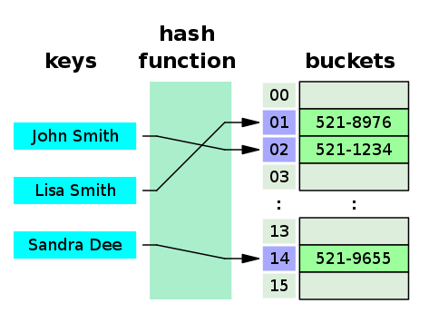

Los métodos **hashCode()** y **equals()** de la programación en Java tienen un contrato mutuo y, además, no pueden funcionar el uno sin el otro; son **interdependientes**. Esta relación simbiótica define la necesidad fundamental de implementarlos a la vez y de forma armoniosa en las definiciones de clase, ya que cumplen papeles complementarios en las comparaciones de objetos y en las estructuras de datos basadas en hash.

En efecto, los métodos **hashCode()** y **equals()** se consideran compañeros inseparables en la definición de una clase. Su presencia conjunta en una clase es clave para evitar numerosos bugs o errores que pueden ser difíciles de detectar y corregir. La existencia conjunta de ambos métodos garantiza un tratamiento completo y preciso de las comparaciones de objetos y de las estructuras de datos basadas en hash, y contribuye de forma notable a la fiabilidad y la integridad del código.

En este artículo nos adentraremos en los detalles del método **hashCode()** en el lenguaje de programación Java. Para empezar, sentaremos las bases explorando definiciones fundamentales para entender este tema. Es esencial reforzar estas definiciones con conceptos más complejos y críticos.

A continuación, nos adentraremos en la aplicación del mecanismo de hashing en Java y desmenuzaremos los detalles del método **hashCode()**, mostrando cómo funciona dentro del entorno de ejecución de Java. Por último, exploraremos la conexión inseparable entre los métodos **equals()** y **hashCode()**. Esta exploración implicará entender ciertas estructuras de datos y aclarar cómo se coordinan y se complementan estos métodos dentro de ellas.

Hay una fuerte interconexión entre los conceptos que se tratan en este artículo y el “método **equals()**” de la programación en Java. Entender el “método equals()” es crucial para comprender el contenido de [**este**](https://medium.com/@mr-yakar/how-to-write-equals-in-java-5e9a908045a1) artículo. Si no conoces bien el “método equals()”, te recomiendo que te detengas aquí y te familiarices primero con ese contenido. Mejorará notablemente tu comprensión de los temas que se tratan aquí, dada su estrecha relación.

Empecemos la introducción con algunas definiciones.

---

## ¿Qué es el hashing?

En términos sencillos, el hashing es el proceso de transformar un conjunto de datos en otra forma. En esencia, consiste en convertir un valor en otro valor. El valor convertido resultante es irreversible y suele llamarse “hash”.

## ¿Qué es una función hash?

Según [Wikipedia](https://en.wikipedia.org/wiki/Hash_function);

> Una función hash es cualquier función que pueda usarse para asignar datos de tamaño arbitrario a valores de tamaño fijo.

En esencia, una función hash está pensada para producir un valor convertido de tamaño fijo usando alguno de los algoritmos matemáticos de hashing. Además, existen algoritmos concretos que pueden generar valores convertidos de tamaño variable.

Considera la siguiente función ‘h’ como ejemplo de función hash:

> h(k) = k (mod 10)

Como *k* representa la clave, se generan los siguientes hashes;

> h(1) = 1

> h(12) = 2

> h(896543) = 3

Desde luego, para convertir datos se emplean diversos algoritmos matemáticos. Sin embargo, si un método permite devolver directamente los datos convertidos a su forma original, no se ajusta a los principios del hashing; entra más bien en la categoría de codificación/decodificación, que puede ser un tema de discusión aparte.

Del mismo modo, si se usa una clave única para convertir los datos y hace falta otra clave, igual o distinta, para devolverlos a su estado original, ese proceso se conoce como cifrado/descifrado. Estos conceptos se apartan de las propiedades fundamentales del hashing y podrían explorarse en un artículo aparte.

Una función hash funciona con un algoritmo **unidireccional**, es decir, los datos se transforman en otra forma de manera **irreversible**. Esta transformación irreversible impide recuperar los datos originales. En la función ‘h’ mencionada antes, la operación módulo de las matemáticas, por ejemplo, es un proceso irreversible. Por ejemplo, tanto 12 mod 10 como 22 mod 10 dan 2, lo que indica que valores distintos como 12 y 22 no pueden obtenerse de forma unívoca a partir de la salida.

Sin embargo, que claves distintas generen resultados idénticos plantea un problema importante en el hashing, llamado colisión de hash. Los detalles sobre la colisión se explicarán en una de las próximas secciones.

La calidad y la idoneidad de un algoritmo de hashing dependen de varias propiedades críticas, entre ellas la capacidad de producir resultados únicos, la irreversibilidad y el cálculo rápido del hash. Estas propiedades son clave para determinar la eficacia y la fiabilidad de un algoritmo matemático de conversión empleado para hashing.

En efecto, el hashing ofrece numerosas ventajas y se emplea ampliamente en ámbitos diversos como las matemáticas, la seguridad de los datos, la comunicación electrónica y otros. Cada uno de estos campos aprovecha las técnicas de hashing según sus necesidades concretas.

En informática, el hashing se usa sobre todo junto con las estructuras de datos, en particular en las tablas hash. Explorar los entresijos de la estructura de datos tabla hash aclarará cómo se aplica el hashing y qué importancia tiene en el ámbito de la informática.

## ¿Qué es una tabla hash?

Según [Wikipedia;](https://en.wikipedia.org/wiki/Hash_table)

> En informática, una tabla hash, también conocida como mapa hash, es una estructura de datos que implementa un array asociativo o diccionario. Es un tipo abstracto de datos que asigna claves a valores. Una tabla hash usa una función hash para calcular un índice, también llamado código hash, en un array de cubetas o ranuras, en el que puede encontrarse el valor deseado. Durante la búsqueda, se aplica el hash a la clave y el hash resultante indica dónde está almacenado el valor correspondiente.

En pocas palabras, una tabla hash consta de claves en su forma hash y de los valores correspondientes. Examinemos el siguiente ejemplo de tabla hash tal como se describe en Wikipedia:



*Una pequeña agenda telefónica como tabla hash — imagen: Jorge Stolfi, [CC BY-SA 3.0](https://creativecommons.org/licenses/by-sa/3.0/), vía [Wikimedia Commons](https://commons.wikimedia.org/wiki/File:Hash_table_3_1_1_0_1_0_0_SP.svg).*

Como se ve en la descripción, la función hash procesa el nombre completo de la persona para generar la salida, que se usa como clave dentro de la tabla hash. Mientras tanto, el número de teléfono de la persona se almacena como valor correspondiente. Una de las principales ventajas de una tabla hash es que la complejidad temporal de las operaciones de búsqueda, inserción y borrado es O(1), lo que significa un procesamiento casi instantáneo.

## ¿Qué es una colisión de hash?

Volviendo al ejemplo inicial que se dio al principio del artículo, la función hash, denominada ‘h’, calcula esencialmente el hash determinando el módulo de la clave dividida entre 10.

> h(k) = k (mod 10)

En este contexto, el valor 10 representa el tamaño de la tabla. Esta especificación garantiza que el hash generado quede siempre dentro de los límites definidos por el tamaño de la tabla.

Examinemos la definición básica de hash según Wikipedia. Una función hash toma entradas de tamaño arbitrario y produce una salida de tamaño fijo. Este tamaño fijo de salida corresponde al tamaño de la tabla, que pone un límite a la memoria disponible para almacenar valores en ella. En consecuencia, es posible que entradas distintas den el mismo valor hash. He aquí un ejemplo que ilustra este concepto:

> h(1) = 1

> h(121) = 1

> h(1653552771) = 1

La observación indica que la función hash, denominada ‘h’, genera el mismo resultado hash para valores de clave distintos. Esto se debe a las características de la función hash y a que el tamaño de la tabla hash está fijado en 10. Este fenómeno suele llamarse “**colisión de hash**”. Las colisiones de hash plantean retos importantes, que afectan tanto a la seguridad como al rendimiento.

El escenario descrito es el de la página de inicio de sesión de un sitio web en el que las contraseñas de los usuarios se almacenan como valores hash, de modo que a nadie le resulta fácil acceder a las contraseñas originales en texto plano, debido a la naturaleza irreversible de las funciones hash. Sin embargo, si la función hash está mal diseñada, se vuelve vulnerable a la explotación por parte de personas malintencionadas. En tal caso, un actor malicioso podría aprovechar las vulnerabilidades de la función hash para crear colisiones de hash.

Generando estas colisiones, un atacante podría intentar iniciar sesión en el sitio web con la cuenta de otra persona. Con una función hash mal diseñada, crear colisiones resulta relativamente fácil. Además, en algunos casos un atacante podría incluso intentar descifrar directamente la contraseña original mediante ataques de fuerza bruta, aprovechando las debilidades del diseño de la función hash.

Este escenario subraya la importancia crítica de usar funciones hash robustas y bien diseñadas para proteger información sensible como las contraseñas de los usuarios. Una función hash bien diseñada reduce considerablemente el riesgo de explotación maliciosa y de acceso no autorizado a las cuentas de los usuarios.

Cuando hay pocas colisiones de hash o ninguna, la búsqueda dentro de estos arrays es rápida, aunque en teoría sea **O(n)**, porque los arrays son relativamente pequeños. Sin embargo, a medida que aumenta el número de colisiones, con menos valores hash distintos y arrays asociativos más grandes, la complejidad temporal para encontrar el par clave-valor correcto puede pasar de un eficiente **O(1)** a un menos eficiente **O(n)**. Esto se vuelve especialmente problemático con grandes cantidades de datos.

Existe un enfoque matemático interesante que busca distribuir uniformemente las colisiones entre los arrays asociativos para optimizar el rendimiento de la función hash. Sin embargo, este concepto se tratará en un artículo aparte.

La probabilidad de que ocurra varía de un algoritmo a otro. Veamos algo de información básica;

[**CRC-32:**](https://en.wikipedia.org/wiki/Cyclic_redundancy_check) Es el que tiene el mayor riesgo de colisiones de hash. Si ya hay 77163 valores hash, la probabilidad de una colisión de hash es del 50 %, lo cual es altísimo en comparación con los demás algoritmos.

[**MD5:**](https://en.wikipedia.org/wiki/MD5) Es el algoritmo de hash más usado. Si ya hay 5060 millones de valores hash, la probabilidad de tener una colisión de hash es del 50 %, algo bastante mejor que CRC-32.

[**SHA-1:**](https://en.wikipedia.org/wiki/SHA-1) Es el que ofrece el menor riesgo de colisión de hash de estos tres algoritmos. Para que el algoritmo SHA-1 llegue a un riesgo de colisión de hash del 50 %, tiene que haber ya 1,42 × 10²⁴ valores hash.

Sigamos con el hashing desde el punto de vista de Java.

---

## La función hash en Java

Una vez cubiertos el mecanismo de hashing y algunos algoritmos de hash posibles, la siguiente sección se centrará directamente en el mecanismo de hashing del lenguaje de programación Java.

En el lenguaje de programación Java, el mecanismo de hashing lo proporciona un método llamado **hashCode()**, que forma parte de la clase **java.lang.Object**. Antes de entrar en los detalles de cómo usar este método, exploremos algunos detalles de su implementación real.

La función hash de Java **depende** de la **Máquina Virtual de Java (JVM)** sobre la que se ejecuta. Esto implica que una JVM puede calcular un valor y otra JVM, un valor distinto. La razón es sencilla: el método **hashCode()** es en realidad un método nativo, escrito en un lenguaje distinto de Java. Esta función la proporcionan bibliotecas internas de la JVM, y estas bibliotecas pueden variar de una JVM a otra. Si quieres examinar la firma real del método **hashCode()** en **java.lang.Object**, consulta el siguiente fragmento de código:

```java
public native int hashCode();
```

Este fragmento de código muestra la firma del método **hashCode()** en la clase **java.lang.Object**, que indica su implementación nativa.

En el lenguaje de programación Java, “native” es una palabra reservada que se usa al integrar funciones de una biblioteca externa no escrita en Java. Como la implementación real puede variar entre distintas máquinas virtuales de Java (JVM), los entresijos de estas posibles implementaciones se omitirán en este artículo; merecen su propia discusión.

La siguiente sección es esencial y no puede saltarse, porque atañe directamente al tema de este artículo. El método **hashCode()** se rige por un contrato concreto.

### La consistencia del valor hash

La documentación oficial especifica que el método **hashCode()** debe devolver siempre el mismo entero como valor hash mientras las invocaciones se hagan sobre el mismo objeto durante la ejecución en curso de la aplicación. Consideremos una clase ya implementada llamada ‘Pencil’. Imaginemos que ejecutamos el programa, creamos un objeto de la clase ‘Pencil’ y después ejecutamos dos veces el método **hashCode()** sobre el objeto, así:

```java
Pencil a = new Pencil();
```

```
int firstHashCodeCalculation = a.hashCode();
int secondHashCodeCalculation = a.hashCode();
```

```
boolean same = firstHashCodeCalculation == secondHashCodeCalculation;
```

La variable ‘same’, definida en último lugar, debe valer ‘true’ para cumplir el primer principio del contrato de **hashCode()**. Este principio es de una importancia excepcional, porque exige excluir cualquier variable inconsistente de nuestra implementación del método **hashCode()**. Por ejemplo, es desaconsejable incluir un valor de **java.util.Random**. Del mismo modo, añadir una variable de **java.util.Date** al cálculo del valor hash es un ejemplo de implementación incorrecta, ya que podría generar valores que cambian constantemente.

### Consistencia de los métodos equals() y hashCode()

> Las relaciones se alimentan de credibilidad, honestidad y constancia.
>
> — Scott Borchetta

El segundo principio del contrato de **hashCode()** estipula que, si dos objetos se consideran iguales según el método **equals()**, sus valores hash también deben ser idénticos. Este aspecto depende de la calidad de la implementación de nuestro método **hashCode()**. Para lograrlo, hay que emplear las mismas propiedades en los métodos **hashCode()** y **equals()**. Cualquier cambio en las propiedades que no se usan no producirá un resultado distinto en el método **hashCode()** ni en el método **equals()**.

El quid de este principio está en el uso de colecciones basadas en hash. Volvamos ahora a nuestra clase hipotética ‘Pencil’. En este escenario, supongamos que tiene tres propiedades distintas: ‘brand’, ‘color’ y ‘size’. Todas estas propiedades se incluyen en el método **equals()**, pero no hemos dado una implementación del método **hashCode()**. Dicho de otro modo, no se ha usado ninguna de las propiedades empleadas en el método **equals()**. Este es el fragmento de código:

```java
Pencil a = new Pencil("Rotring", "Black", 0.5);
Pencil b = new Pencil("Faber Castell", "Black", 0.5);
Pencil c = new Pencil("Faber Castell", "Red", 1.0);

Map<Pencil, Integer> pencilPriceMap = new HashMap<>();
pencilPriceMap.put(a, 100);
pencilPriceMap.put(b, 120);
pencilPriceMap.put(c, 150);

int price = pencilPriceMap.get(new Pencil("Rotring", "Black", 0.5));
```

Podríamos suponer que el precio será 100, pero no será así. Aquí es donde nos topamos con los problemas. Si pretendemos usar objetos de la clase Pencil como claves de un hash map, debemos sobrescribir el método **hashCode()** y emplear las mismas propiedades que se usan en el método **equals()**.

### Un criterio de rendimiento del método hashCode()

> No puedes rendir de forma constante de una manera que no concuerde con cómo te ves a ti mismo.
>
> — Zig Ziglar

El último principio dice que los códigos hash resultantes no tienen por qué ser distintos cuando dos objetos no son iguales según el método **equals()** de la clase correspondiente. Sin embargo, es mejor que lo sean, por cuestiones de rendimiento.

Al principio de este artículo explicamos cómo se producen las colisiones de hash. Aquí nos encontramos con una situación similar. Volvamos una vez más a nuestra clase hipotética ‘pencil’. Tiene las mismas propiedades que en el principio anterior, pero esta vez su método **hashCode()** calcula siempre el mismo hash para todos los objetos, distintos o iguales. Este es el fragmento de código que lo demuestra:

```java
Pencil a = new Pencil("Rotring", "Black", 0.5);
Pencil b = new Pencil("Faber Castell", "Black", 0.5);
Pencil c = new Pencil("Faber Castell", "Red", 1.0);

Map<Pencil, Integer> pencilPriceMap = new HashMap<>();
pencilPriceMap.put(a, 100);
pencilPriceMap.put(b, 120);
pencilPriceMap.put(c, 150);

pencilPriceMap.get(new Pencil("Rotring", "Black", 0.5));
```

Como las claves de todos los objetos son iguales y todos se añaden a la misma cubeta, dado que la clave del hash map se deriva del código hash del objeto, la complejidad temporal de una operación get pasa de **O(1)** a **O(n)**, lo que en la práctica convierte nuestro mapa en una lista. Esto supone una pérdida de rendimiento importante.

No afecta a la lógica en tiempo de ejecución, pero sí al rendimiento. Para sacar partido de una tabla hash, es evidente que debemos dar una implementación de **hashCode()** que no viole el tercer principio del contrato de **hashCode()**.

---

## En conclusión

Como es obvio, los métodos **hashCode()** y **equals()** forman un dúo inseparable y deben tomarse muy en serio al implementar tu código. En la web hay numerosas fuentes disponibles, y te recomiendo no fiarte solo de este artículo, sino explorar también otras fuentes.

Como siempre, ¡gracias por leer!
