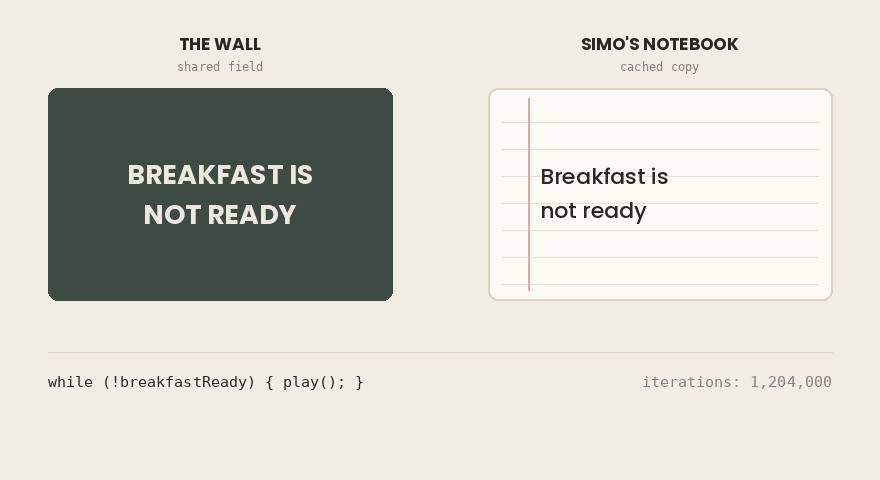
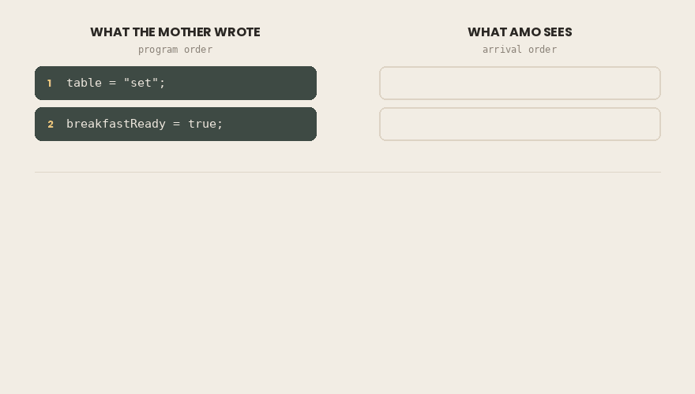
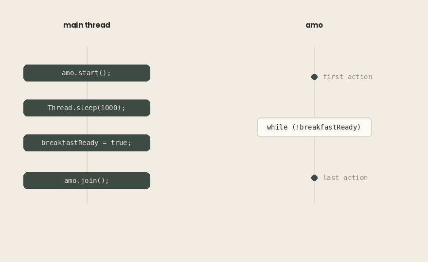
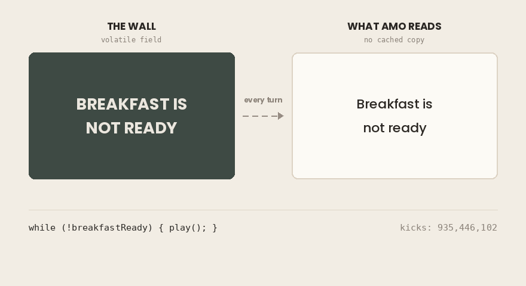
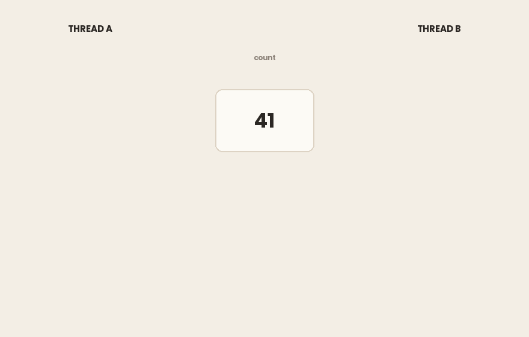

## TL;DR

- Un campo no `volatile` escrito por un hilo puede no hacerse **nunca** visible para otro hilo. No es un retraso. No hay ninguna cantidad de espera que lo arregle.
- El **compilador JIT** puede sacar la lectura de un campo fuera de un bucle y convertir `while (!flag) {}` en `if (!flag) { while (true) {} }`. Entonces el bucle gira para siempre.
- El compilador y la CPU también pueden **reordenar** tus escrituras. Otro hilo puede ver la escritura n.º 2 antes que la n.º 1. Es legal.
- El **Modelo de Memoria de Java (JMM)** es una especificación, no una descripción del hardware. Enumera lo que *no puede* ocurrir. Todo lo que no está prohibido está permitido.
- **happens-before** es la única relación de orden que importa. Sin una arista happens-before entre una escritura y una lectura, no hay nada garantizado.
- Las aristas salen de una lista corta: el orden del programa, el desbloqueo/bloqueo de un monitor, la escritura/lectura `volatile`, `Thread.start()`, `Thread.join()`, la interrupción y la inicialización por defecto, más la transitividad.
- `volatile` crea una arista. Publica **todo** lo que hizo el hilo escritor antes de la escritura, no solo el campo marcado.
- `volatile` te da **visibilidad**, no **atomicidad**. `count++` sigue siendo tres operaciones y sigue estando roto con concurrencia.

En las frescas mañanas de verano, Amo se escapaba a la calle a jugar a la pelota mientras sus padres todavía dormían.

Solo había una regla: tenía que volver a casa cuando el desayuno estuviera listo. Y, en lugar de gritar de un lado a otro de la calle y despertar a los vecinos, la madre de Amo escribía la noticia en el muro que había delante de la casa.

*El desayuno no está listo.*

El muro estaba al otro extremo de la calle. Consultarlo significaba parar el partido, bajar corriendo, leer y volver corriendo.

Eso es lo que hacía las primeras mañanas.

Aquella mañana, la madre de Amo salió de la cocina, cogió la tiza, borró el muro y escribió un mensaje nuevo:

**¡EL DESAYUNO ESTÁ LISTO!**

Luego volvió a entrar. Puso la mesa. Sirvió el té. Desde algún punto de la calle llegaba el golpe regular de un balón contra la puerta de un garaje.

No vino nadie.

Los huevos se enfriaron.

En Java pasa lo mismo:

```java
public class Breakfast {

    static boolean breakfastReady = false;

    public static void main(String[] args) throws InterruptedException {
        Thread amo = new Thread(() -> {
            long kicks = 0;
            while (!breakfastReady) {
                kicks++;
            }
            System.out.println("Amo came home after " + kicks + " kicks.");
        });

        amo.start();
        Thread.sleep(1000);

        breakfastReady = true;
        System.out.println("The wall says: BREAKFAST IS READY!");

        amo.join();
        System.out.println("Breakfast is served.");
    }
}
```

```bash
The wall says: BREAKFAST IS READY!
^C
```

En mi máquina se cuelga siempre: cinco ejecuciones, cinco cuelgues, cinco interrupciones a mano.

La escritura ocurrió. El mensaje es correcto. El programa está mal.

¿Por qué?

### En resumen

- Un hilo pone un `boolean` a `true`. Otro hilo gira en un bucle hasta que se vuelve `true`.
- La escritura ocurre sin ninguna duda: la prueba está impresa en la pantalla.
- El bucle no termina nunca. Hay que matar el programa a mano.

## La mentira cómoda en la que creemos

> Un hilo escribe en un campo. Otro hilo lo lee. El segundo ve el valor que se escribió.
>
> Nadie te enseñó esto. Nunca te hizo falta aprenderlo, porque nunca se te ocurrió cuestionarlo.

Mira otra vez la salida. La escritura ocurrió: la prueba está en la pantalla. El lector sigue viendo el valor antiguo. La **suposición está rota**, y el programa que la rompió no hace nada ingenioso.

Amo no jugaba solo. Su amiga Simo jugaba con él, y Simo llevaba un cuaderno en el bolsillo.

El cuaderno se copiaba del muro una vez, al empezar el partido. El muro estaba al otro extremo de la calle, y Simo no era perezosa. Tenía razón. Nadie le dijo que lo copiara. Lo dedujo ella sola.

El muro se actualizó. El cuaderno, no.

El primer villano: la **copia obsoleta**.



Hay un segundo villano, y estuvo en la historia desde el principio.

La madre escribió LISTO, luego puso la mesa y luego sirvió el té. Si Amo hubiera llegado a casa entre esos momentos, habría encontrado una mesa vacía y un vaso vacío. El mensaje era correcto, pero no era real.

**El orden en que escribes no es una promesa sobre el orden en que se ejecuta.**

Ninguno de los dos villanos es un defecto. Los dos son **optimizaciones**, y los dos suelen acertar. El cuaderno de Simo le ahorró cien viajes calle abajo, y la reordenación que te costará una tarde de depuración es la misma maquinaria que hace que todos los demás programas de tu portátil sean lo bastante rápidos para usarlos.

> **Unas palabras sobre el muro.**
>
> El cuaderno es una imagen honesta del primer villano. Hay una cosa en el mundo, guarda una copia y la copia se queda desfasada. Puedes señalarla.
>
> El segundo villano no tiene nada así. Nada en la calle reordena la mañana de la madre. Si escribió antes de poner la mesa, fue decisión suya, y las decisiones son del programador. La reordenación real no la decide nadie que haya escrito el código. Se le **permite** que le ocurra.
>
> Ahí es donde se acaba el muro. Puedes dibujar un cuaderno. No puedes dibujar un permiso.

Es tentador archivar esto bajo **lentitud**. Una copia se queda obsoleta, el valor nuevo tarda un rato en llegar, el bucle da unos miles de vueltas de más. Molesto, pero limitado.

Mira otra vez lo que pasó. Amo no volvió tarde a casa. No volvió. Los huevos se enfriaron y siguieron fríos, y el programa seguía en ejecución cuando lo mataste.

Hay algo más pequeño que debería inquietarte más. Añadir un print dentro del bucle cambió el resultado. La lentitud no se comporta así. A la lentitud no le importa qué más hay en la habitación.

Así que hazte la pregunta obvia: ¿cuánto tendrías que esperar? No hay ningún número. Ni uno grande: ninguno. Y el número que falta no es un hueco de este artículo.

### En resumen

- Dos problemas distintos pueden ocultar una escritura a otro hilo: una **copia obsoleta** y la **reordenación**.
- Ninguno de los dos es un fallo de la JVM. Los dos son optimizaciones que son correctas casi siempre.
- No es lentitud. Lento significa tarde. Esto significa nunca.

## Visibilidad: ver no está garantizado

La explicación obvia es que el valor llega tarde.

Es una teoría razonable, y merece una prueba justa. En informática, las cachés se quedan obsoletas por todas partes, y lo obsoleto se refresca. Tu resolutor de DNS se pone al día. Tu CDN se pone al día. Tu navegador se pone al día si esperas lo suficiente o le das dos veces a recargar. La palabra *caché* lleva dentro una promesa: mal por ahora, bien con el tiempo. Unos cuantos millones de iteraciones desperdiciadas no son nada para un procesador moderno. Amo tarda en darse cuenta. Amo se dará cuenta.

Dos experimentos dicen lo contrario.

El primero puede que ya lo hayas hecho sin querer. Pon un `println` dentro del bucle, junto a donde Amo patea el balón, y el programa se para: en mi máquina, tras unos trece millones de patadas. No cambió nada de la espera. Lo que cambió es que **ahora hay algo más en la habitación**. A la lentitud no le importa qué más hay en la habitación.

El segundo experimento es más difícil de rebatir, porque no toca el código en absoluto.

```bash
$ java Breakfast.java
The wall says: BREAKFAST IS READY!
^C
```

```bash
$ java -Xint Breakfast.java
The wall says: BREAKFAST IS READY!
Amo came home after 105349152 kicks.
Breakfast is served.
```

`-Xint` le dice a la JVM que se ejecute en modo intérprete y se salte la optimización.

> **Entorno**
>
> - Intel Core i7–4700HQ (4 núcleos / 8 hilos, x86–64)
>
> - 16 GB DDR3
>
> - Ubuntu 26.04
>
> - Amazon Corretto 21.0.11 (OpenJDK 21, HotSpot, modo mixto)

El mismo archivo. La misma máquina. Una opción. La segunda ejecución vuelve a casa tras cien millones de patadas: **mucha más espera** de la que la primera necesitó nunca. Esperó más y lo consiguió. La primera esperó para siempre y fracasó.

Así que lo que cambió no es cuánto esperó nadie. Lo que cambió es **lo que la máquina tenía permitido hacer con el código**.

Merece la pena detenerse aquí, porque el instinto ahora es buscar un arreglo. Esperar más. Poner un `Thread.sleep` en el bucle. Llamar a `Thread.yield`. Darle más trabajo al bucle para que vaya más lento.

Algunos de estos parecerán funcionar.

Es el peor resultado posible. Un cambio que oculta el fallo sin prometer nada no ha arreglado el programa. Ha eliminado tu única prueba de que algo va mal. El fallo sobrevive, el síntoma se va y publicas con una confianza que no te has ganado. Esta es la forma de todo **Heisenbug**: reacciona a que lo observen, y mirarlo de la manera equivocada lo hace desaparecer.

Hazte la pregunta directamente. ¿Cuánto tendrías que esperar?

No hay respuesta. Ni un número grande ni uno impredecible: **no hay ningún número**, porque el ingrediente que falta no es el tiempo. Esperar más no te lleva hasta allí, igual que esperar no puede convertir el lunes en martes si el calendario se ha parado.

Lo que significa que la pregunta estaba mal. Preguntar *cuánto* es preguntar por el tamaño de algo que nunca estuvo ahí.

La pregunta correcta es qué haría visible el valor **en absoluto**: no antes, sino en absoluto. Alguien tiene que prometer que una escritura se hace visible para un lector. Nada en el programa que hemos escrito contiene una promesa así.

Entonces: ¿quién promete qué, y a quién?

### En resumen

- Añadir un `println` dentro del bucle hace que el programa se pare. El tiempo no funciona así.
- Ejecutar con `-Xint` hace que el programa se pare, **sin cambiar nada del código**.
- La ejecución con `-Xint` esperó ocho veces más que la ejecución rota y aun así terminó. Así que la espera nunca fue el problema.
- No hay ninguna cantidad de tiempo que arregle esto. La garantía falta, no llega tarde.

## Reordenación: el orden en que escribes no es el orden en que se ejecuta

«¿Por qué el valor nunca se hace visible?» está resuelto. La nueva pregunta: incluso cuando el valor sí se hace visible, ¿en qué orden llega?

```java
// mother
table = "set";
breakfastReady = true;
```

```java
// Amo
if (breakfastReady) {
    eat(table);      // table may still be null
}
```

El razonamiento de Amo es sólido. El muro dice LISTO, así que lo escribió su madre; ella lo escribe cuando la mesa está puesta; por tanto, la mesa está puesta. Cada paso se sigue del anterior. Entra y se encuentra la mesa vacía.

Solo hay un eslabón roto en esa cadena, y no es el que sospecharías. Leyó bien la marca. La madre sí puso primero la mesa. Su orden fue correcto de principio a fin.

El eslabón roto es el que nadie escribe: **que el orden en que ella trabajó es el orden que Amo llega a ver.**

Dentro de un único hilo, ese orden es real. `table = "set"` ocurre de verdad antes que `breakfastReady = true`, y cualquier código de ese hilo lo verá así. La garantía es hermética, y cubre **exactamente a un observador**.

Amo es un observador distinto. A él no se le prometió nada.

Así que el hecho de que `table` sea null mientras `breakfastReady` es true no rompe ninguna regla. El comentario de ese fragmento no te avisa de una carrera rara bajo carga. Describe lo que el programa tiene permitido hacer. No es improbable ni depende del momento: **es legal**.



El compilador y la CPU son libres de reordenar tus instrucciones. La única restricción: un **observador de un solo hilo** no debe poder notarlo.

Tres capas pueden reordenar lo que escribiste: el **compilador y el JIT**, la propia **CPU** (ejecución fuera de orden, store buffers) y el **sistema de memoria** que hay debajo. La mayoría de los desarrolladores suponen que la culpable es la CPU. Más a menudo es el compilador, y el JIT sigue reescribiendo código que ya se está ejecutando.

No tienes que creértelo a ciegas. Vuelve a ejecutar el primer programa con una opción más:

```bash
java -XX:+PrintCompilation Breakfast.java 2>&1 | grep Breakfast
```

```bash
620 1385 %     3       me.yakar.Breakfast::lambda$main$0 @ 2 (28 bytes)
621 1387 %     4       me.yakar.Breakfast::lambda$main$0 @ 2 (28 bytes)
```

El `%` significa **reemplazo en pila** (on-stack replacement): el bucle ya se estaba ejecutando cuando su código se cambió por debajo. El `3` y el `4` son niveles del compilador: primero C1, luego C2, cada uno optimizando de forma más agresiva que el anterior.

Ahora compara las marcas de tiempo con el programa. El hilo principal duerme un segundo antes de poner la marca. Las dos recompilaciones ocurrieron hacia los 620 ms: mientras Amo ya estaba girando, y **antes de que la escritura llegara a producirse**. Cuando la madre cogió la tiza, el bucle ya se había reescrito dos veces, y la versión que se ejecutaba en ese momento era la más optimizada que la JVM podía producir.

El código que acabó ejecutándose no es el que escribiste, y ni siquiera se eligió cuando arrancó el programa.

x86 te da un **orden fuerte** (strong ordering). Los almacenamientos se hacen visibles en el orden en que se emitieron, así que varias categorías de reordenación nunca afloran allí, aunque no todas. **ARM** y **POWER** prometen mucho menos, y son lo que lleva tu teléfono y, cada vez más, tus servidores.

Todos los experimentos de este artículo se ejecutaron en x86–64. Así que hay reordenaciones que no puedo mostrarte aquí: no porque sean raras, sino porque este hardware las suprime. En otros, no. Y el hardware es solo una de las tres capas: el compilador que está por encima es libre de reordenar también en x86, como ya demostró el primer programa en esta misma máquina.

«En mi máquina funciona» no es aquí una prueba débil. **No es una prueba.**

Dos villanos, entonces. Uno nunca te muestra el valor. El otro te lo muestra en un orden que no escribiste.

Ninguno funciona mal. El JIT cumplió su promesa: ningún observador de un solo hilo podía notar la diferencia. La CPU cumplió su promesa. x86 cumplió su promesa. Cada capa se comportó exactamente como estaba especificado.

Nadie le hizo nunca una promesa a tu **segundo hilo**.

### En resumen

- El compilador, el JIT, la CPU y el sistema de memoria pueden reordenar tus instrucciones.
- La única regla que deben cumplir: un observador **de un solo hilo** no debe notarlo. Tu otro hilo no es ese observador.
- `-XX:+PrintCompilation` muestra el bucle recompilándose dos veces mientras ya se está ejecutando.
- x86 oculta algunas reordenaciones. ARM y POWER, no. El mismo código puede comportarse de forma distinta en hardware distinto.

## El Modelo de Memoria de Java (JMM): un contrato, no una máquina

«Nadie le hizo nunca una promesa a tu segundo hilo.» Entonces, ¿quién la hace?

La hace el **JMM**. No es una máquina. Es un modelo que define qué tiene garantizado ver un hilo del trabajo de otro, y en qué orden.

Cuando te imaginas el JMM, probablemente te imaginas hardware: cachés, núcleos, store buffers. Ese es otra vez el cuaderno, y ya se te avisó. Puedes dibujar un cuaderno, pero no un permiso. La imagen es útil para la intuición y errónea como definición.

Aquí está la prueba. ¿De qué otra forma obtienes dos resultados distintos del mismo programa en la misma máquina? Recuerda `-Xint`. Una opción, ningún cambio de código, ningún cambio de hardware, y el bucle que giraba para siempre ahora termina. Lo que cambió es lo que la JVM tenía **permitido** hacer. Si una regla no se puede leer en el hardware, el hardware no es su origen.

Entonces, ¿quiénes son las partes?

De un lado, tú. Del otro, todas las implementaciones de la JVM en todas las arquitecturas en las que vayan a ejecutarse jamás: HotSpot en x86, OpenJ9 en POWER, lo que se ejecute en hardware que todavía no se ha diseñado. El JMM no describe cómo se comporta una máquina. Define el **mínimo** que todas ellas deben cumplir.

Y aquí el contrato va en la dirección que no esperarías. No te dice qué *va a* ocurrir. Te dice qué *no puede* ocurrir. Es una **lista de prohibiciones**, no una lista de promesas.

Lo que significa que todo lo que no está prohibido es legal. La ejecución que observaste es una ejecución lícita entre muchas. Mañana puede que obtengas otra distinta, y las dos son correctas. Por eso **las pruebas no pueden demostrar la ausencia de un fallo de concurrencia**: una batería de pruebas en verde te dice qué ejecución te tocó, no cuáles estaban disponibles.

Podrías concluir de todo esto que no se te ha dado nada. Es justo al revés. El contrato es exactamente lo que te permite escribir código en un MacBook y ejecutarlo en un servidor ARM sin pensar en ninguno de los dos. Sin él, «escribe una vez, ejecuta en cualquier parte» seguiría valiendo para un único hilo y se rompería en silencio en cuanto arrancaras un segundo, y estarías ajustando store buffers para cada arquitectura, a mano.

Entonces: hay un contrato. Las partes se conocen. Queda una pregunta.

¿En qué idioma están escritas sus cláusulas?

### En resumen

- El JMM es una **especificación**, no una descripción de ninguna CPU concreta.
- Obliga a todas las JVM en todas las arquitecturas, incluido el hardware que todavía no existe.
- Funciona enumerando lo que **no puede** ocurrir. Todo lo demás está permitido.
- Una prueba que pasa te muestra una ejecución legal. No te muestra las demás.

## Happens-before: la letra pequeña del contrato

En el habla corriente, «una cosa ocurre antes que otra» es una afirmación sobre el tiempo: horas, minutos, una lectura del reloj menor que otra. Aquí ese instinto es una trampa. Las cláusulas de este contrato no tratan del **tiempo**. Tratan del **orden**.

Cuando A **happens-before** B, todo lo que hizo A es visible para B, y B queda ordenado después. Ese es todo el contenido de la expresión.

El guion importa. **ocurrir antes ≠ happens-before.**

La escena de la madre te lo da gratis. `table = "set"` ocurrió literalmente antes que `breakfastReady = true`, según cualquier reloj que quieras sacar. Pero no había ninguna arista happens-before que llegara hasta Amo, así que a él no se le garantizó nada. El tiempo pasó. La garantía, no.

El contrato tiene una lista corta de cláusulas. Cada una crea una arista happens-before; nada más lo hace.

**Orden del programa.** Dentro de un único hilo, cada acción happens-before todas las acciones que vienen después en el código fuente. Hermético, y limitado a un hilo.

**Bloqueo de monitor.** El desbloqueo de un monitor happens-before todo bloqueo posterior de ese mismo monitor.

**Volatile.** Una escritura en un campo `volatile` happens-before toda lectura posterior de ese mismo campo.

**Inicio de hilo.** Una llamada a `start()` sobre un hilo happens-before cualquier acción del hilo iniciado.

**Terminación de hilo.** Todas las acciones de un hilo happen-before que otro hilo vuelva de `join()` sobre él.

**Interrupción.** Que un hilo interrumpa a otro happens-before que el hilo interrumpido lo detecte.

**Inicialización.** La inicialización por defecto de un campo (`0`, `false`, `null`) happens-before cualquier otra acción del programa.

Y la regla que hace que el resto merezca la pena:

**Transitividad.** Si A happens-before B y B happens-before C, entonces A happens-before C.

Dos de estas cláusulas mencionan una palabra clave concreta y un par de métodos concreto. Todo lo demás de la lista es automático o algo que ya haces sin pensar.

Lo que nos lleva a una observación incómoda sobre el programa que llevas ejecutando desde el principio. Ya contiene **dos aristas happens-before**. Las escribiste sin darte cuenta.

`amo.start()` es una: todo lo que hizo el hilo principal antes de esa llamada tiene garantizado ser visible para Amo. `amo.join()` es la otra, en sentido contrario: todo lo que hizo Amo tiene garantizado ser visible para el hilo principal una vez que `join()` vuelve.

Fíjate en dónde está la escritura:

```java
amo.start();             // edge #1
Thread.sleep(1000);
breakfastReady = true;   // no edge
amo.join();              // edge #2
```



La escritura ocurre **después** de `start()`, así que la regla del inicio no la cubre. Ocurre **antes** de que `join()` vuelva, pero Amo no está leyendo nada después de `join()`: está girando dentro. La única escritura que importa en todo el programa es la única acción que no está unida a ninguna arista de la lista.

Ese es el fallo. No una caché, no un compilador, no una arquitectura. **Una cláusula que falta.**

Antes llamamos permiso a la reordenación. Happens-before es la correa.

Donde existe una arista, la reordenación no desaparece: la máquina puede seguir barajando instrucciones por debajo. Lo que no puede es dejar que ese barajado **se haga visible** a través de la arista. Es la misma forma de antes: el contrato no describe lo que hace el hardware. Describe lo que tienes permitido observar.

Así que ya conoces el idioma en el que están escritas las cláusulas, y sabes que a tu programa le falta una.

Todavía no sabes cómo escribirla.

### En resumen

- **happens-before** trata del orden y la visibilidad, no del reloj.
- Que algo ocurra antes en el tiempo no garantiza nada entre hilos.
- La lista completa de aristas es corta: el orden del programa, el desbloqueo/bloqueo de un monitor, la escritura/lectura `volatile`, `start()`, `join()`, la interrupción y la inicialización por defecto, más la transitividad.
- Nuestro programa ya tenía dos aristas (`start()` y `join()`). La única escritura que importaba no tenía ninguna.

## volatile: el campo siempre sincronizado

Vuelve a la lista. Una cláusula hace exactamente lo que le falta a este programa: *una escritura en un campo volatile happens-before toda lectura posterior de ese mismo campo.*

Así que añadimos una palabra clave:

```java
static volatile boolean breakfastReady = false;
```

No cambia nada más en el archivo. Vuelve a ejecutarlo:

```bash
The wall says: BREAKFAST IS READY!
Amo came home after 1700811096 kicks.
Breakfast is served.
```



Amo miró el muro, el de verdad, al otro extremo de la calle, como hacía las primeras mañanas. Lo leyó y echó a correr.

Los huevos todavía estaban calientes.

La mitad de esto es obvia. La lectura ya no puede sacarse del bucle. Cada vuelta vuelve al campo y pregunta otra vez.

Ahí es donde se paran la mayoría de las explicaciones. Es la mitad pequeña.

Esta es la otra. La arista no lleva solo `breakfastReady`. **Lleva todo lo que hizo el hilo escritor antes de ella.**

Lo que significa que la escena de la madre también funciona ahora. `table = "set"` vino antes de la escritura volatile, así que queda en el lado seguro de la arista. Amo ve una mesa puesta, no una null.

Y `table` no es volatile. Nadie la tocó.

Nada de esto es gratis. Pero el coste no está donde la mayoría lo pone.

La historia habitual es así: un campo volatile se salta la caché y va hasta la RAM, en cada lectura y cada escritura. Ordenado, fácil de recordar y falso. Si fuera cierto, volatile sería inutilizable: la memoria principal es unas doscientas veces más lenta que la caché L1. En x86, una lectura volatile cuesta más o menos lo mismo que una corriente.

Esto es lo que ocurre en realidad.

**Las cachés nunca fueron el problema.** Los procesadores modernos las mantienen sincronizadas entre sí, en hardware, sin que nadie se lo pida. Un núcleo escribe un valor; las cachés de los demás núcleos se enteran. Esa maquinaria funciona escribas o no `volatile`.

Lo que *no* se mantiene sincronizado es una copia guardada en un **registro**. Los registros son el espacio de trabajo privado de la CPU, y nada los coordina con nada. Ahí es donde vive de verdad el cuaderno de Simo. No en la caché: en un registro. El compilador lo puso ahí porque leer el mismo campo una y otra vez parecía un desperdicio, y nada lo prohibía.

Así que la primera mitad del coste la paga el **compilador**. Pierde jugadas. No puede aparcar el campo en un registro, no puede sacar la lectura del bucle, no puede reutilizar un valor que leyó hace un momento. Cada vuelta es una lectura real.

La segunda mitad se paga en la **escritura**. En x86, a una escritura volatile la sigue una barrera que obliga al procesador a vaciar sus escrituras pendientes antes de que pueda continuar nada de lo que viene después. Esa espera es la parte cara. Las lecturas son casi gratis; las escrituras son donde llega la factura.

El cuaderno ha desaparecido. Amo corre al muro cada vez, y la madre ahora espera junto al muro hasta que lo escrito está de verdad ahí.

Así que el programa está arreglado, la historia tiene un final y tienes una palabra clave que resuelve el problema con el que empezaste.

Lo cual es un buen momento para tener cuidado.

### En resumen

- `volatile` crea una arista happens-before, que es exactamente la cláusula que faltaba.
- La arista publica **todo** lo que hizo el hilo escritor antes de la escritura, no solo el campo marcado.
- `volatile` no empuja los datos a la RAM. Las cachés ya las mantiene sincronizadas el hardware. Lo que impide es que el compilador guarde una copia en un **registro**.
- Las lecturas son baratas. El coste está en la **escritura**, por la barrera de memoria que la sigue.

## Lo que volatile NO te da

Una palabra clave, una línea, problema resuelto. Es una buena sensación, y vale la pena conservarla durante una página, más o menos.

Lleva la misma palabra clave un paso más allá y mira cómo se desmorona.

Dos hilos, un contador, un millón de incrementos cada uno. El campo es volatile, así que la visibilidad está resuelta.

```java
public class Counter {
    static volatile int count = 0;

    public static void main(String[] args) throws InterruptedException {
        Runnable job = () -> {
            for (int i = 0; i < 1_000_000; i++) {
                count++;
            }
        };

        Thread a = new Thread(job);
        Thread b = new Thread(job);

        a.start(); b.start();
        a.join();  b.join();

        System.out.println("expected: 2000000");
        System.out.println("actual:   " + count);
    }
}
```

```makefile
expected: 2000000
actual:   1422924
```

Ejecútalo otra vez y obtendrás un número distinto. Ejecútalo unas cuantas veces más y puede que obtengas el correcto, lo que es peor que obtener el incorrecto: el mismo punto que hizo la sección de la reordenación, llegando otra vez desde otra dirección.

Faltan casi seiscientos mil incrementos. ¿Adónde fueron?

`count++` parece una sola instrucción. **Son tres.**

Leer el valor. Sumar uno. Escribirlo de vuelta.

Ahora mete dos hilos dentro de esos tres pasos. Los dos leen 41. Los dos suman uno. Los dos escriben 42. Entraron dos incrementos y salió uno.



Fíjate bien en lo que *no* salió mal ahí. Nada estaba obsoleto. Los dos hilos leyeron un valor perfectamente actual: la cláusula volatile hizo su trabajo exactamente como está escrita. Solo que leyeron el **mismo**.

Son dos garantías distintas, y vale la pena decir sus nombres en voz alta.

La **visibilidad** trata de si ves el último valor. La **atomicidad** trata de si una operación puede interrumpirse a medias.

`volatile` te da la primera. Nunca te ha dado la segunda. Todo lo que había en este artículo hasta ahora trataba de la primera.

No es un hueco del lenguaje ni un defecto de `volatile`. Vuelve a la cláusula: *una escritura en un campo volatile happens-before toda lectura posterior de ese mismo campo.* Léela otra vez y fíjate en lo que no menciona. No dice nada de dos hilos que se turnan. Nada de una operación que se ejecuta de principio a fin sin interferencias.

Le pediste al contrato una cláusula que nunca estuvo en él. Y el contrato hizo lo que ha hecho todo el tiempo: cumplió su palabra, con precisión, y nada más.

Las herramientas para la otra garantía existen, y no son esta. `AtomicInteger` para un contador como este. `synchronized` o un `Lock` cuando varios campos tienen que moverse juntos. `LongAdder` cuando el contador está muy disputado. Cada una de ellas merece su propio artículo. Ninguna es `volatile`.

Así que quédate con la palabra clave, y quédatela para lo que es: la herramienta adecuada para un trabajo concreto. Un hilo escribe un valor, otros hilos lo leen y la escritura de nadie depende de lo que acaba de leer. Una marca de estado. Una señal de apagado. Una referencia que se publica una vez y luego se deja en paz.

En el momento en que una escritura depende del valor que acabas de leer, `volatile` ya no basta, y necesitas otra cláusula.

### En resumen

- `volatile` da **visibilidad**. No da **atomicidad**.
- `count++` es leer, sumar, escribir. Dos hilos pueden meterse dentro de esos tres pasos y perder una actualización.
- En ese fallo no había nada obsoleto. Los dos hilos leyeron un valor actual: el mismo.
- Usa `AtomicInteger`, `synchronized`, un `Lock` o `LongAdder` cuando una escritura dependa del valor que se acaba de leer.

## La chuleta del contrato

Empezaste con un programa que no se paraba. Ahora sabes por qué, y resultó que la respuesta no tenía casi nada que ver con el programa.

Esto es lo que te conviene llevarte.

**1. La visibilidad no es cuestión de tiempo.**

Un valor que no tiene garantizado llegar no llega tarde. Puede que no llegue nunca. No hay ninguna duración que arregle una garantía que falta, y por eso añadir un sleep, ralentizar el bucle o esperar más no son arreglos: en el mejor de los casos ocultan el fallo y te cuestan la prueba.

**2. El orden en que escribes no es el orden en que se ejecuta.**

El compilador, el JIT y el procesador pueden reordenar tus instrucciones. La única restricción es que un observador de un solo hilo no debe poder notarlo. Tu segundo hilo no es ese observador.

**3. El JMM es un contrato, no una máquina.**

No describe cachés, núcleos ni store buffers. Define el mínimo que debe respetar toda JVM en toda arquitectura. Funciona enumerando lo que no puede ocurrir, lo que significa que todo lo que no está prohibido es legal, y la ejecución que observaste fue una ejecución lícita entre muchas. Las pruebas te muestran cuál te tocó, no cuáles estaban disponibles.

**4. Happens-before es la única moneda.**

Nada es visible entre hilos a menos que una arista lo haga visible. Las cláusulas son pocas y no hay ninguna extra secreta: el orden del programa, del desbloqueo al bloqueo de un monitor, de la escritura a la lectura volatile, de `start()` al hilo, del hilo a `join()`, de la interrupción a su detección, la inicialización por defecto. Y la transitividad, que es lo que permite encadenarlas en algo útil.

**5.** `volatile` **compra visibilidad, no atomicidad.**

Crea una arista, y la arista lleva todo lo que hizo el hilo escritor antes de ella, no solo el campo que marcaste. Lo que no hace es volver indivisible una operación. `count++` sigue siendo tres pasos, y dos hilos siguen cabiendo dentro.

**La pregunta que hay que hacerse**

La próxima vez que veas un campo que toca más de un hilo, no te preguntes si parece seguro para hilos. Hazte dos preguntas:

**¿Quién lo escribe, y qué cláusula garantiza que el lector lo vea?**

Si no puedes nombrar la cláusula, es que no la hay. Ni una garantía pequeña, ni una probable, ni una que se cumple casi siempre en tu portátil. No la hay.

Los huevos se enfrían en silencio, y el programa sigue en ejecución.

## Referencias

**Especificación**

- *The Java® Language Specification, Chapter 17: Threads and Locks* (§17.4.5).
 [https://docs.oracle.com/javase/specs/jls/se8/html/jls-17.html](https://docs.oracle.com/javase/specs/jls/se8/html/jls-17.html)
- *JSR-133: Java Memory Model and Thread Specification* (2004)
 [https://www.cs.umd.edu/~pugh/java/memoryModel/jsr133.pdf](https://www.cs.umd.edu/~pugh/java/memoryModel/jsr133.pdf)
- *JSR-133 (Java Memory Model) FAQ* 
 [https://www.cs.umd.edu/~pugh/java/memoryModel/jsr-133-faq.html](https://www.cs.umd.edu/~pugh/java/memoryModel/jsr-133-faq.html)

**Implementación y hardware**

- Doug Lea, *The JSR-133 Cookbook for Compiler Writers*
 [https://gee.cs.oswego.edu/dl/jmm/cookbook.html](https://gee.cs.oswego.edu/dl/jmm/cookbook.html)
- Rajiv Prabhakar, *Myths Programmers Believe about CPU Caches*
 [https://software.rajivprab.com/2018/04/29/myths-programmers-believe-about-cpu-caches/](https://software.rajivprab.com/2018/04/29/myths-programmers-believe-about-cpu-caches/)
